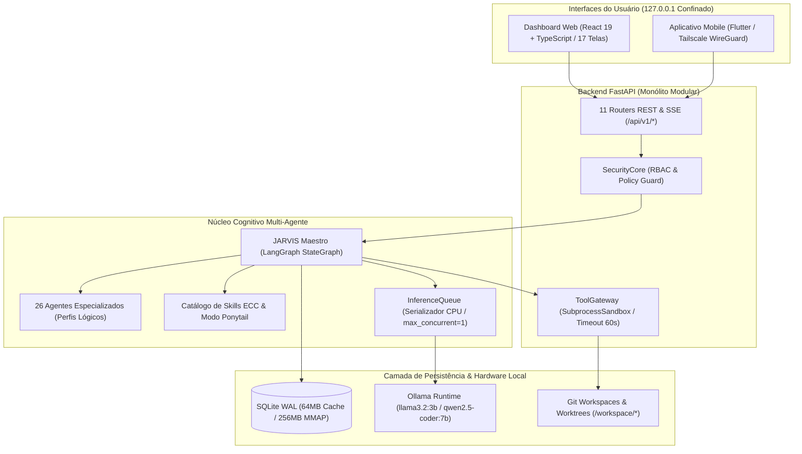

# ⚡ JARVIS AI HUB 3.0.1 (Candidato de Homologação)

<div align="center">

**Candidato 3.0.1 · Plataforma Corporativa Local-First de 26 Agentes Especializados de IA para Análise, Engenharia de Software, Cibersegurança, Dados, Escritório Virtual Gamificado e Gestão de Projetos Físicos**

[](RELEASE_2.0.md)
[](docs/operations/12-plano-de-testes-benchmarks-e-release.md)
[](docs/security/07-threat-model-e-politica-de-seguranca.md)
[](docs/architecture/04-catalogo-26-agentes-e-permissoes.md)
[](RELEASE_2.0.md)

</div>

---

## 📖 Sumário Executivo do Candidato 3.0.1

O **JARVIS AI HUB 3.0.1** é uma evolução arquitetural que transforma a orquestração de IA local em uma experiência corporativa rica, autônoma e gamificada:
1. **26 Microsserviços Especialistas Autônomos**: Cada agente possui perfil cognitivo exclusivo, competências ECC ativas, chaves de API independentes (Groq, Gemini, DeepSeek, OpenAI ou Ollama local) e isolamento operacional.
2. **Escritório Virtual ("Habbo Office" 2.5D Canvas)**: Simulação viva com ciclo de caminhada a 60 FPS, pausa para o café, mesas departamentais e convocação dinâmica para a Mesa Redonda de Consenso.
3. **Invocação Direta de Especialistas & Inspeção Física**: Convoque qualquer especialista (como o Engenheiro de Cibersegurança) para auditar códigos reais em `workspace/<projeto>` com injeção automática de arquivos e pareceres técnicos contextualizados.
4. **Interface Clean One Obsidian Glassmorphism**: Layout ultra-minimalista, sidebar com submenus colapsáveis organizados, histórico de conversas unificado e Paleta de Comandos (`Ctrl+K`).
5. **Cofre de Chaves Multi-Provider (KeyVault)**: Gestão granular de credenciais com atribuição individual de modelo e chave por agente.

A premissa mandatória da engenharia é que **modelos de linguagem não possuem autoridade externa sobre suas próprias permissões ou sobre o sistema anfitrião**. Toda execução física de comandos, testes e escritas em disco é governada por uma autoridade externa determinística (*SecurityCore*), sandboxes estritas (*ToolGateway*) e aprovação humana (*ApprovalCenter*).

---

## 📚 Índice dos 13 Documentos Canônicos do Projeto

Toda a fundamentação técnica, auditorias de segurança e manuais operacionais estão organizados nos documentos abaixo:

| # | Documento Canônico | Descrição | Localização |
| :-: | :--- | :--- | :---: |
| **01** | **Visão e Requisitos do Produto (PRD)** | Personas, dores endereçadas, requisitos funcionais (RF) e não funcionais (RNF). | [01-visao-e-requisitos-do-produto.md](docs/architecture/01-visao-e-requisitos-do-produto.md) |
| **02** | **Arquitetura e Fluxos de Dados** | Monólito modular, fluxos de chat SSE, diagrama de persistência e Clean Architecture. | [02-arquitetura-e-fluxos-de-dados.md](docs/architecture/02-arquitetura-e-fluxos-de-dados.md) |
| **03** | **Decisões de Arquitetura (ADRs)** | Justificativas formais do Monólito Modular, SQLite WAL, LangGraph e Fila de CPU. | [docs/adr/](docs/adr/) |
| **04** | **Catálogo dos 26 Agentes e RBAC** | Tabela dos 26 especialistas, prompts cognitivos, modelos padrão e matriz de permissões. | [04-catalogo-26-agentes-e-permissoes.md](docs/architecture/04-catalogo-26-agentes-e-permissoes.md) |
| **05** | **Catálogo de Ferramentas e Schemas** | ToolGateway, contratos de argumentos Pydantic, limites de sandbox e bloqueio de path traversal. | [05-catalogo-ferramentas-e-schemas.md](docs/architecture/05-catalogo-ferramentas-e-schemas.md) |
| **06** | **Catálogo de Skills, Licenças e Versões** | Competências ECC nativas, skills importadas, Modo Ponytail (YAGNI/DRY) e hashes SHA-256. | [06-catalogo-skills-licencas-e-versoes.md](docs/architecture/06-catalogo-skills-licencas-e-versoes.md) |
| **07** | **Threat Model e Política de Segurança** | Análise STRIDE, fronteiras de confiança, Kill Switch, mascaramento e proteção contra prompt injection. | [07-threat-model-e-politica-de-seguranca.md](docs/security/07-threat-model-e-politica-de-seguranca.md) |
| **08** | **Manual de Instalação no Windows** | Passo a passo com Python, Node, Ollama, `.venv`, dependências e inicialização local. | [08-manual-instalacao-e-configuracao-windows.md](docs/operations/08-manual-instalacao-e-configuracao-windows.md) |
| **09** | **Manual de Operação, Backup e Recuperação** | Hot backups em modo WAL, recuperação de desastres, expurgo de tarefas e desfragmentação. | [09-manual-operacao-backup-e-recuperacao.md](docs/operations/09-manual-operacao-backup-e-recuperacao.md) |
| **10** | **Manual do Project Workspace e Fluxo Git** | Importação de pastas, modos Read-Only/Plan-Only/Write, branches temporárias e diffs. | [10-manual-project-workspace-e-fluxo-git.md](docs/operations/10-manual-project-workspace-e-fluxo-git.md) |
| **11** | **Manual do Dashboard e App Mobile** | Guia de uso das 17 páginas modulares, atalho `Ctrl+K`, comandos de chat e pareamento VPN Tailscale. | [11-manual-dashboard-e-app-mobile.md](docs/operations/11-manual-dashboard-e-app-mobile.md) |
| **12** | **Plano de Testes, Benchmark e Release** | Pirâmide de testes, benchmark SQLite reproduzível e critérios de promoção de release. | [12-plano-de-testes-benchmarks-e-release.md](docs/operations/12-plano-de-testes-benchmarks-e-release.md) |
| **13** | **Auditoria de Paridade: Claude Code & OpenCode** | Matriz de paridade, lacunas identificadas por severidade, roadmap P0/P1/P2 e critérios de aceite do Coding Agent. | [13-auditoria-paridade-claude-code-opencode.md](docs/architecture/13-auditoria-paridade-claude-code-opencode.md) |

---

## 🏛️ Arquitetura de Alto Nível



---

## 🤖 Catálogo dos 26 Agentes Especialistas

Os 26 agentes são divididos em 6 divisões corporativas de engenharia:

```
┌────────────────────────────────────────────────────────────────────────┐
│                        JARVIS AI HUB (26 AGENTES)                      │
├─────────────────────┬─────────────────────┬────────────────────────────┤
│ 📐 ARQUITETURA      │ 💻 ENGENHARIA SW    │ 🧪 QUALIDADE & QA          │
│ • JARVIS Maestro    │ • Dev Frontend      │ • Engenheiro de QA         │
│ • Arquiteto Software│ • Dev Backend       │ • Revisor de Código Sênior │
│ • Gerente Projetos  │ • Pipelines ETL     │ • Auditor Código Seguro    │
│ • Analista Pesquisa │ • Dev Automação     │ • Esp. Segurança de APIs   │
│ • Designer Produto  │                     │                            │
│ • Designer UX/UI    │                     │                            │
├─────────────────────┼─────────────────────┼────────────────────────────┤
│ 📊 DADOS & BI       │ 🚀 DEVOPS & INFRA   │ 🛡️ CIBERSEGURANÇA          │
│ • Cientista de Dados│ • Engenheiro DevOps │ • Eng. Cibersegurança      │
│ • Business Intel.   │ • Eng. Redes/Infra  │ • Arquiteto STRIDE         │
│ • Eng. Inteligência │                     │ • Gestão Identidade (IAM)  │
│                     │                     │ • Supply Chain (SBOM)      │
│                     │                     │ • Resposta a Incidentes SOC│
│                     │                     │ • Red Team de Segurança IA │
│                     │                     │ • Privacidade (LGPD/GDPR)  │
└─────────────────────┴─────────────────────┴────────────────────────────┘
```

> **Consulta Completa**: Detalhes contratuais de cada agente estão disponíveis em [`docs/architecture/04-catalogo-26-agentes-e-permissoes.md`](docs/architecture/04-catalogo-26-agentes-e-permissoes.md).

---

## 📊 Benchmarks e evidências

Os números históricos de RPS/WPS foram removidos desta apresentação porque o script que os originou não estava versionado de forma reproduzível. O projeto agora inclui `scripts/benchmark_sqlite.py`, que mede exclusivamente o SQLite em modo WAL.

Execute com:

```powershell
python scripts/benchmark_sqlite.py --reads 1000 --writes 300 --readers 15 --writers 8
```

O resultado JSON informa plataforma, versões, concorrência, latências, throughput agregado e integridade. **Não representa desempenho HTTP, inferência de modelos ou homologação integral do produto.** Resultados só devem ser publicados depois de execução identificada por commit e ambiente.

## 🖥️ Matriz das 17 Telas do Dashboard Web

O painel está modularizado. A homologação de responsividade e acessibilidade permanece sujeita aos gates automatizados e testes manuais.

1. **Chat Master**: Streaming de tokens em tempo real (SSE), suporte a entrada de voz, gaveta de histórico e comandos rápidos (`/ponytail`, `/debate`, `/rollback`).
2. **Workspace & Projetos**: Importador de pastas locais, criação de branches de teste, geração de diffs e exportação de backup em ZIP limpo.
3. **Gerenciador de Tarefas**: Painel com 4 cards de KPIs, busca textual, filtros de intenção, exclusão unitária e expurgo de tarefas >30d.
4. **Centro de Agentes**: Catálogo visual dos 26 perfis lógicos com playground de teste individual.
5. **Catálogo de Skills**: Painel de competências ECC e seletor interativo do Modo Ponytail (Off, Lite, Senior, Ultra).
6. **Gerenciador de Modelos**: Decomposto em 5 submódulos (`ModelStatusHero`, `HybridGatewayConfig`, `AgentRecommendationTable`, `HuggingFaceHubSection`, `LocalModelsGrid`).
7. **Diagnóstico de Hardware**: Monitorização de CPU, RAM e GPU, com alocador dinâmico de threads para o Ollama e perfis de energia.
8. **Logs do Servidor**: Console de telemetria em tempo real via SSE, histórico de inferências e métricas de tokens/segundo.
9. **Approval Center**: Interceptador Human-in-the-Loop com visualização de diffs coloridos e bloqueio de autoaprovação por IA.
10. **Security Center**: Decomposto em Contenção/Kill Switch, Trilha de Auditoria ao Vivo, Scanner de CVEs offline e Red Team sandbox.
11. **Overview do Sistema**: Telemetria consolidada, status de integridade do hub e monitoramento de fila.
12. **Backend Studio**: Decomposto em Mock Server nativo com rotas coringas (`/api/v1/mock/*`) e SQL Playground com auditor `EXPLAIN QUERY PLAN`.
13. **Quality Studio**: Executor de testes automatizados com semáforo visual, gerador de scripts Playwright E2E e Chaos Testing.
14. **Design Studio**: Seletor de paletas com conformidade WCAG 2.1 AAA e visualizador de componentes em tempo real.
15. **Relatório Executivo**: Cálculo de ROI, economia acumulada em comparação à nuvem e exportação em Markdown/PDF.
16. **Modais Globais**: Assistente de configuração inicial (*Setup Wizard*), Perfil do Desenvolvedor e Paleta de Comandos (`Ctrl+K`).
17. **Coding Agent**: Agente de código real com loop de *tool calling*, leitura/escrita de arquivos, execução de comandos em sandbox, diffs com backup `.bak`, `git_commit` com aprovação, ferramentas MCP externas e histórico persistido por sessão. O chat clássico usa o mesmo runtime conversacional (memória + streaming real), com o orquestrador preservado para ações que exigem aprovação.

---

## 🚀 Como Iniciar em 3 Passos (Windows)

### 1. Baixar os modelos recomendados no Ollama
```powershell
ollama pull llama3.2:3b
ollama pull qwen2.5-coder:7b
```

### 2. Ativar o ambiente virtual e instalar dependências
```powershell
.venv\Scripts\Activate.ps1
pip install -e .
```

### 3. Iniciar o servidor local
```powershell
python -m uvicorn apps.api.main:app --host 127.0.0.1 --port 8000
```

Abra o seu navegador em: **`http://127.0.0.1:8000`**

---

## 🔒 Compromissos de Engenharia & Segurança

* **Local-first**: o servidor inicia em `127.0.0.1` por padrão; acessos remotos exigem configuração explícita e HTTPS.
* **Zero Snake_case Visível na UI**: Toda a interface foi rigorosamente traduzida para Português do Brasil claro e profissional.
* **Auditoria em andamento**: a suíte e os gates estão a ser executados na branch de homologação. Nenhum total de testes ou selo de aprovação é declarado sem evidência associada ao commit.
* **Governança Human-in-the-Loop**: Nenhuma linha de código ou arquivo de projeto é alterado sem autorização explícita do desenvolvedor humano.
* **Extensibilidade Controlada**: Servidores MCP são opcionais, definidos em `data/mcp_servers.json`, e ferramentas externas seguem a mesma política de risco e aprovação das nativas.

---

<div align="center">
Desenvolvido com foco em Privacidade, Rigor de Engenharia de Software e Eficiência Local-First.
</div>


---

## Estado de homologação 3.0.1

Esta branch é um candidato de homologação, não uma declaração de produção. Os números de **265 testes**, **0 ignorados** e **329,17 kB** só serão publicados após execução verificável da suíte e do build, com artefatos ligados ao commit. Nenhum resultado de benchmark antigo deve ser interpretado como desempenho atual.

A versão 3.0.1 está alinhada nos metadados do backend, dashboard e mobile. A tag Git de release será criada apenas depois de todos os gates passarem e da assinatura Android de produção ser configurada pelo responsável pela custódia do keystore.
