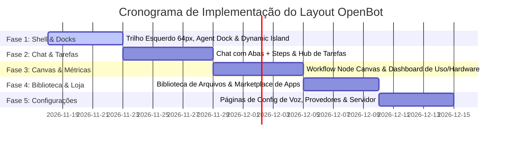

# PLANO MESTRE DE EVOLUÇÃO INTEGRADA — JARVIS AI HUB (VERSÃO OPENBOT UNIFIED)
> **Versão:** 4.0.0-PRO · **Data:** Novembro de 2026 · **Status:** Plano de Design & Arquitetura Unificada  
> **Escopo:** Adoção Total do Design System do OpenBot, Integração de Todas as 8 Telas Principais, Dynamic Island, Dock de Agentes Flutuante à Direita, Persistência Dual-Engine e Paridade de Código.

---

## 1. Visão Geral da Arquitetura Visual do OpenBot

A análise minuciosa das **14 imagens capturadas do OpenBot** revela um dos designs mais refinados, funcionais e minimalistas do mercado de IA. A interface substitui barras de menu pesadas por uma **grade ergonômica de 4 zonas**:

```
+---------------------------------------------------------------------------------------------------------+
|                                    [ Dynamic Island: 🟣 👋 ]                                            |
+----+-----------------------+-------------------------------------------------------------------+--------+
| R  | GAVETA DE CONTEXTO    | ÁREA DE TRABALHO PRINCIPAL                                        | DOCK   |
| A  | (Sub-menu retrátil    |                                                                   | DE     |
| I  | dependente da página) | [💬 Calmon Dev +]               [💻 ollama/qwen2.5-coder:7b v]    | AGENTES|
| L  |                       | ----------------------------------------------------------------- | (Direi-|
|    | Pesquisar...          |                                                                   |  ta)   |
| 💬 |                       | 2 etapas >                                                        |        |
| 🔀 | QA Tester             | [x] Perguntas canceladas                                          |  (🟣)  |
| ✓: | Copy Editor           |                                                                   |  (🔵)  |
| 📈 | Bug Fixer             |                      Você: Como está o computador?                |  (🟠)  |
| 🗄️ | Security              |                                                                   |  (🟢)  |
| ⋯  | Design                | JARVIS:                                                           |   +    |
|    |                       | Vou verificar o estado do computador: CPU, memória e temperatura. |        |
| 🏬 |                       | 12 etapas > [Desdobramento de tools]                              |        |
| ❓  |                       |                                                                   |        |
| ⚙️ |                       | ----------------------------------------------------------------- |        |
| 👤 |                       | [ + ] [ Mensagem para JARVIS...                ] [🎙️] [🔊]        |        |
+----+-----------------------+-------------------------------------------------------------------+--------+
```

---

## 2. As 4 Zonas de Layout do OpenBot Aplicadas ao JARVIS

### Zona 1: Trilho Esquerdo Fixo (Ultra-Slim Rail - 64px)
Um trilho escuro ultra-compacto (`#111113`) que concentra os acessos rápidos sem poluir a visão:
* **Topo:** Ícone da aplicação (Bot Lilás com olhos).
* **Meio (Ícones Fixos e Pinos Personalizáveis):**
  1. `💬` **Chat / Conversas**
  2. `🔀` **Fluxos de Trabalho** (Canvas de Nós)
  3. `✓:` **Tarefas** (Hub de Delegação)
  4. `📈` **Uso & Custos** (Telemetria de Tokens e Hardware)
  5. `🗄️` **Biblioteca** (Todos os Arquivos e Projetos)
  6. `⋯` **Menu de Mais Apps:** Popup estilo OpenBot com `Rotinas`, `Agenda`, `Provedores` e ícone de pino (`📌`) para o usuário escolher o que fica no trilho!
* **Base:**
  * `🏬` **Loja** (Marketplace de Apps, Agentes e Skills)
  * `❓` **Ajuda & Novidades** (Changelog de releases, Guias, Discord, Feedback)
  * `⚙️` **Configurações** (Voz, Provedores, Dynamic Island, Celular)
  * `👤` **Perfil / Seletor de Servidor** (Dropdown de servidores e instâncias)

---

### Zona 2: Gaveta de Contexto Retrátil (Sidebar de Sub-Navegação - 240px)
Essa barra lateral adapta seu conteúdo dinamicamente conforme a página ativa no trilho:
* **No Chat:** Busca de conversas, grupos de agentes (`Sem seção`, etc.) e lista de chats com data e status.
* **Na Biblioteca:** `Todos os arquivos`, `Recentes`, `Fora de pastas`, e pasta de `Agentes`.
* **Na Loja:** `Apps`, `Agentes`, `Habilidades` e lista de `Seus apps conectados` (Telegram, WhatsApp, GitHub, etc.).
* **Nas Configurações:** Abas categorizadas: `Geral`, `Aparência`, `Notificações`, `Voz`, `Conta` (Perfil, Cobrança, Conectar celular) e `Este computador` (Dynamic Island, Dock de agentes).

---

### Zona 3: Dynamic Island Superior & Top Bar
* **Dynamic Island Flutuante:** Pílula preta com cantos arredondados no topo central da tela:
  * Exibe o avatar do agente ativo com animações expressivas (aceno `👋`, escuta ativa, sono/idle).
  * Ondas senoidais reativas ao microfone durante conversas de voz.
* **Barra de Abas Superior:** Permite abrir múltiplas conversas ou fluxos em abas (`[Calmon Dev] [+]`).
* **Seletor de Modelo Integrado:** No canto superior direito da conversa, dropdown rápido: `[💻 ollama/qwen2.5-coder:7b v]` com atalhos de ferramentas.

---

### Zona 4: Dock de Agentes Flutuante à Direita (Agent Dock - 56px)
Um dos elementos visuais mais marcantes do OpenBot:
* Uma barra flutuante na extremidade direita com **avatares 3D coloridos em estilo squircle**:
  * 🟣 **QA Tester** (Rosa / Lilás)
  * 🔵 **Copy Editor** (Azul elétrico)
  * 🟠 **Bug Fixer** (Laranja energético)
  * 🟢 **Security / Designer** (Verde esmeralda)
  * `+` **Adicionar Agente**
* **Funcionalidade:** Clicar num avatar troca imediatamente a conversa para aquele especialista ou convoca o agente para participar do chat atual!

---

## 3. Catálogo Completo das 8 Telas Extraídas do OpenBot para o JARVIS

Com base nas 14 capturas de tela enviadas, mapeamos a implementação idêntica de cada tela dentro do JARVIS AI HUB:

---

### Tela 1: Chat Multimodal com Desdobramento de Etapas (Image 2)
```
+---------------------------------------------------------------------------------+
| [💬 Calmon Dev] [+]                               [💻 ollama/qwen2.5-coder:7b v]|
|                                                                                 |
| 2 etapas >                                                                      |
| [x] Perguntas canceladas                                                        |
|                                                                                 |
|                                   [ Como está o computador? ] (Bolha Coral)     |
|                                                                                 |
| Vou verificar o estado do computador: CPU, memória, disco e temperatura.       |
| CPU load veio vazio, vou medir o uso real de CPU e processos.                   |
|                                                                                 |
| 12 etapas >                                                                     |
|   ├── [✓] Coletando métricas via psutil (CPU: 31%, RAM: 33%)                   |
|   ├── [✓] Verificando disco C:\ (250GB livres)                                  |
|   └── [✓] Inspecionando temperatura dos núcleos                                |
|                                                                                 |
| [ + ] [ Mensagem para Calmon Dev                               ] [🎙️] [🔊]      |
+---------------------------------------------------------------------------------+
```
* **Elementos-chave:**
  * Pílulas colapsáveis `2 etapas >` e `12 etapas >` que guardam o raciocínio e as tool calls sem poluir a leitura.
  * Mensagens do usuário em formato pílula arredondada em tom coral (`#e05244`).
  * Barra inferior limpa com botão `+` (anexar arquivo/imagem), input de texto, ícone de microfone e botão de reprodução de voz.

---

### Tela 2: Hub de Tarefas & Delegação em Paralelo (Image 4)
* **Cabeçalho Inspirador:**  
  * *"Delegue o trabalho. **Volte para uma resposta.**"*  
  * *"Seus agentes trabalham em tarefas em paralelo. Cada resposta espera você aqui."*
* **Barra Central de Delegação:**
  * Dropdown: `[🔵 Telegram Orchestrator v]` + Campo: *"O que você quer que seja feito?"* + Botões: `[🎙️]` `[⬆️ Enviar]`.
* **Painel de Tarefas Agrupadas:**
  1. **Precisa de você (1):** Tarefas aguardando aprovação humana com badge `Respondida` (azul).
  2. **Trabalhando (1):** Tarefas ativas com spinner animado: *"Encontre artigos recentes sobre recuperação..."* com badge roxa `Pesquisando no arxiv.org`.
  3. **Em espera (1):** Tarefas agendadas ou em standby com badge cinza `Em espera`.

---

### Tela 3: Editor de Fluxos de Trabalho em Grafo / Nós (Image 3)
* **Cabeçalho:** `Fluxos de trabalho sem título v`
* **Canvas Infinito:** Fundo preto com grade de pontos sutis (*dot grid*).
* **Nó Inicial:** Cartão com ícone de raio: *"Comece com um gatilho"* $\to$ Botão `+ Adicionar gatilho`.
* **Barra de Ferramentas Flutuante Inferior:**
  * Controles de zoom: `[ - 100% + ]`, tela cheia `[ ⛶ ]`, minimapa `[ 🗺️ ]`.
  * Ferramentas: Ponteiro (Select), Mão (Pan), Lápis (Draw), Post-it (Sticky Note), Cartão (Node), Texto (`T`), Busca (`🔍`), e botão central `+ Adicionar nó`.

---

### Tela 4: Dashboard de Uso, Custos & Hardware (Image 5)
* **Barra de Status do Hardware no Topo:**
  * `⚙️ 31% CPU` · `💻 33% RAM` · Dropdowns de filtro: `Todos os agentes v` · `Custo v` · `30 dias v` · Botão de atualização.
* **Métrica Principal:** `US$ 0,00` (*2 sessões · Estimativa de API · USD*).
* **Gráfico Temporal:** Linha temporal de custo diário com curva suave de 30 dias.
* **Detalhamento de Provedor:** Item expansível `• 💻 OpenCode CLI (12,42 mil tokens)`.
* **Grid de Totais de Tokens:**
  * *Tokens sem leitura de cache:* `12,42 mil`
  * *Tokens processados com leituras de cache:* `12,42 mil`
  * *Entrada em cache:* `0`
  * *Entrada sem cache:* `11,92 mil`
  * *Saída:* `499 tokens`

---

### Tela 5: Biblioteca de Arquivos & Projetos (Images 1 e 6)
* **Cabeçalho:** `Todos os arquivos` + busca `"Pesquisar na biblioteca"` + botões de criar pasta, visualização em grade `[::]` e lista `[≡]`.
* **Categorias:** `Todos os arquivos`, `Recentes`, `Fora de pastas`, e pasta de `Agentes (Todos os 11 agentes)`.
* **Área Central:** Espaço limpo indicando: *"Nenhum arquivo ainda. Os arquivos que você anexa e que os agentes criam aparecem aqui."*

---

### Tela 6: Loja de Apps, Integrações e Habilidades (Image 8)
* **Sub-Menu Esquerdo:** `Apps`, `Agentes`, `Habilidades` e seção de `Seus apps conectados`.
* **Categorias de Ferramentas:**
  * **Produtividade:** Slack, Discord, Telegram (`✓ Conectado`), WhatsApp (`✓ Conectado`), 1Password, Bitwarden.
  * **Documentos:** Coda, Craft, Dropbox, Evernote.
* **Botão:** `+ Adicionar personalizado` para registrar qualquer API ou webhook do usuário.

---

### Tela 7: Configurações de Voz Completas (Images 10 e 11)
* **Seção Ditado (STT):**
  * Modelo: `Parakeet TDT 0.6B v3` (Rápido, detecção automática de 25 idiomas).
  * Idioma: `Automático`.
  * **Pausa antes de enviar (VAD Slider):** `1,5 s` (*"Em uma conversa por voz, o assistente envia suas palavras quando você para de falar por esse tempo."*).
* **Seção Respostas Faladas (TTS):**
  * Modelo: `Supertonic 3` ou `Kokoro TTS` (Lê respostas em voz alta em 31 idiomas).
  * Toggle: `Ler respostas em voz alta` (On/Off).
  * Seletor de voz: `Voz feminina 1` / `Voz masculina 1` com botão `▷ Ouvir`.
  * Controle de velocidade: `1x`, `1.25x`, `1.5x`.

---

### Tela 8: Configurações de Provedores de IA (Image 14)
* **Provedor Padrão:** Dropdown `[OpenCode v]`.
* **Provedores Conectados:**
  * `OpenCode` *(Disponível neste computador)*.
* **Outros Provedores (Catálogo com Status):**
  * `ChatGPT` *(Não baixado / Configurar API Key)*
  * `Claude` *(Não baixado / Configurar API Key)*
  * `Grok` *(Não baixado / Configurar API Key)*
  * `Gemini` *(Não baixado / Configurar API Key)*
  * `Cursor` *(Não baixado / Configurar API Key)*

---

## 4. O Sistema de Navegação Pop-up & Menus (Images 7, 9, 12, 13)

1. **Pop-up de Fixar Atalhos no Trilho (Image 7):**
   * Ao clicar no botão de três pontos (`⋯`) no trilho esquerdo, um pop-up elegante permite fixar ou desafixar itens com um clique no alfinete `📌` (`Rotinas`, `Fluxos de trabalho`, `Tarefas`, `Agenda`, `Uso`, `Biblioteca`, `Provedores`).
2. **Menu de Ajuda & Novidades (Image 9):**
   * Clicando em `❓` no rodapé: feed de atualizações recentes com datas, `🎁 Registro de alterações completo`, links para Guias, Discord e Relatar Problema.
3. **Seletor de Servidores & Instâncias (Image 12):**
   * No rodapé do trilho: indicador `✓ 🟠 OpenBot / JARVIS Local`, com opções `+ Adicionar servidor`, `Configurações do servidor` e `Exibição`.
4. **Dynamic Island com Feedback Animado (Image 13):**
   * Quando o sistema está ativo, um entalhe preto curvo desce suavemente do topo da tela com o avatar do robô lilás e uma mão acenando `👋` para dar as boas-vindas.

---

## 5. Roteiro de Implementação do Layout OpenBot no JARVIS



### Entregáveis Técnicos no Código:
1. **`apps/dashboard/src/components/navigation/PrimaryRail.tsx`:** Trilho de 64px com ícones ativos, estados de hover e menu de pinagem `📌`.
2. **`apps/dashboard/src/components/navigation/AgentDock.tsx`:** Dock vertical direito com bolhas 3D de agentes e botão `+`.
3. **`apps/dashboard/src/components/navigation/DynamicIsland.tsx`:** Notch superior flutuante conectado ao WebSocket de voz e status.
4. **`apps/dashboard/src/components/chat/OpenChatView.tsx`:** Chat com abas, pílulas colapsáveis `X etapas >` e seletor de modelo no header.
5. **`apps/dashboard/src/components/tasks/TasksHubView.tsx`:** Interface de delegação de tarefas (Precisa de você, Trabalhando, Em espera).
6. **`apps/dashboard/src/components/workflows/WorkflowCanvasView.tsx`:** Editor de grafo com dot grid e dock flutuante de ferramentas.
7. **`apps/dashboard/src/components/usage/UsageAnalyticsView.tsx`:** Métricas de CPU/RAM, gráfico de custo e grid de tokens.
8. **`apps/dashboard/src/components/store/AppStoreView.tsx`:** Catálogo de integrações (Slack, WhatsApp, Telegram, etc.).
9. **`apps/dashboard/src/components/settings/VoiceSettingsView.tsx`:** Configurações de Parakeet VAD e Supertonic/Kokoro TTS.

---

## 6. Próximo Passo

O plano está **100% atualizado, incorporando a estética e todas as telas do OpenBot**.

Podemos iniciar a implementação da **Fase 1 do Novo Layout** (*Trilho Esquerdo de 64px + Agent Dock na Direita + Dynamic Island*)?
