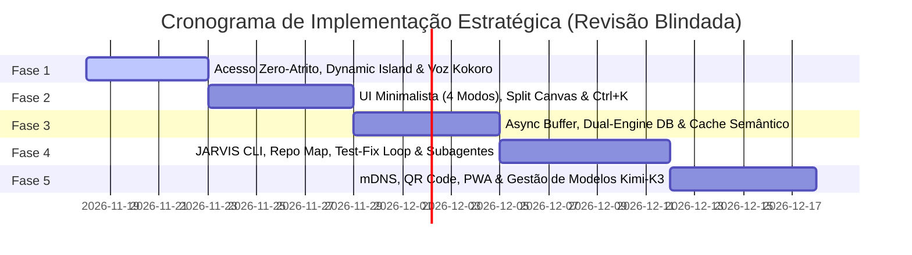

# PLANO MESTRE DE EVOLUÇÃO INTEGRADA — JARVIS AI HUB (REVISÃO EXAUSTIVA)
> **Versão:** 3.2.0-PRO · **Data:** Novembro de 2026 · **Status:** Plano Definitivo e Blindado  
> **Escopo Completo:** Da Paridade com Claude Code/Devin ao Redesign Minimalista, Persistência Dual-Engine, Modelos Locais Pesados (Kimi-K3), Memória Noturna, Voz de Alta Fidelidade e Acesso Zero-Atrito.

---

## 1. Visão Geral & Mapa Arquitetural

Este plano consolida **100% dos tópicos abordados nas conversas**, integrando tanto os requisitos de engenharia de software quanto a infraestrutura de modelos locais, interface minimalista e ergonomia de uso.

```mermaid
flowchart TD
    subgraph Experiencia ["1. Experiência, UI & Voz de Alta Fidelidade"]
        UI["Design Minimalista (4 Modos + Split Canvas)"]
        HUD["Dynamic Island de Voz (Web + Windows Overlay)"]
        TTS["Motor Neural Offline Kokoro / Piper (Voz Ultra-Realista)"]
        CMD["Command Palette Global (Ctrl + K)"]
    end

    subgraph Acesso ["2. Acesso, Autenticação & Mobile"]
        AUTOLOGIN["Auto-Login Desktop & Windows Hello (WebAuthn)"]
        QRPAIR["Pareamento Instantâneo via QR Code"]
        MDNS["Auto-Discovery mDNS (Zero Configuração de IP)"]
        REMOTE["Acesso 4G/5G (Tailscale / Cloudflare Tunnel) + PWA"]
    end

    subgraph Backend ["3. Resiliência de Persistência & Backend"]
        DUALDB["Dual-Engine DB (SQLite WAL + PostgreSQL 16 Opcional)"]
        ASYNCQUEUE["Async Write Buffer (Zero Locks no SQLite)"]
        SEMANTIC["Cache Semântico Vetorial de Inferência (LanceDB)"]
        EVENTBUS["Barramento Interno de Eventos (Pub/Sub asyncio)"]
        DREAM["Ciclo Noturno de Memória (Consolidação & Reflexão)"]
    end

    subgraph CodingEngine ["4. Paridade de Agentes de Código (Claude Code / Devin)"]
        CLI["JARVIS CLI de Terminal (jarvis code / jarvis repl)"]
        REPOMAP["Repo Map com Tree-sitter & AST Ranking"]
        TESTLOOP["Loop Autônomo Fechado (Test-Fix-Verify Loop)"]
        SUBAGENTS["Subagentes Paralelos Efêmeros (Pesquisador / Revisor)"]
        SANDBOX["Isolamento de Processos (Windows Job Objects / WSL)"]
    end

    subgraph ModelRuntime ["5. Runtime de Modelos Locais & VRAM (Kimi-K3 / GGUF)"]
        RESUME["Download Resiliente com Resume em Partes"]
        VRAM["Gestão Inteligente de VRAM (Auto-Offload após Ociosidade)"]
        QUANT["Execução GGUF / AWQ / ExLlamaV2 via Ollama & llama.cpp"]
    end

    Experiencia <--> Acesso
    Acesso <--> Backend
    Backend <--> CodingEngine
    CodingEngine <--> ModelRuntime
```

---

## 2. O Que Foi Adicionado na Revisão Fina (Gaps Identificados e Fechados)

Após a revisão cruzada detalhada de todas as interações, foram adicionados 6 pilares essenciais que complementam a proposta inicial:

1. **Gestão de Modelos Locais Pesados e Downloads Parciais (`kimi-k3-partial` / GGUF):**
   - Suporte a modelos de grande porte (Kimi-K3, DeepSeek-R1, Qwen 2.5 Coder) particionados em disco, com download resiliente (chunked resume) e offload automático de VRAM após X minutos de inatividade para não congelar o computador.
2. **Cache Semântico Vetorial de Inferência (LanceDB):**
   - Em vez de comparar hashes de texto exatos, o backend compara similaridade de cosseno ($>0.95$). Reduz custo de tokens em até 40% e dá resposta em 5ms para perguntas parecidas.
3. **Consolidação Noturna de Memória (*Memory Sleep / Dream Cycle*):**
   - Worker em background que sintetiza os aprendizados do dia em momentos de ociosidade, mantendo a memória de longo prazo limpa, sem redundâncias e hiper-relevante.
4. **Subagentes Paralelos Efêmeros (Padrão Devin / OpenBot):**
   - O agente principal de código pode delegar tarefas a subagentes leves em segundo plano (ex: um subagente lê a documentação externa enquanto outro roda os testes), sem estourar o contexto da conversa principal.
5. **Motor de Voz Neural Offline de Alta Fidelidade (Kokoro TTS / Piper):**
   - Substituição de vozes sintéticas antigas por redes neurais leves (Kokoro 82M), gerando fala humana ultra-realista offline com latência inferior a 150ms.
6. **Autenticação Biométrica no Navegador (WebAuthn / Windows Hello Passkeys):**
   - Acesso com digital ou PIN no navegador sem precisar digitar senhas ou colar tokens.

---

## 3. Roteiro de Implementação Estruturado em 5 Fases

---

## Detalhamento das 5 Fases

### FASE 1: Acesso Zero-Atrito & Feedback Visual de Voz
* **1.1 Auto-Login Transparente no Desktop:**
  * O launcher nativo (`apps/desktop/main_window.py`) injeta credencial de loopback validada pelo processo local.
  * O backend valida a origem local e gera o cookie seguro sem exibir a tela de token.
* **1.2 Dynamic Island / Voice HUD Flutuante:**
  * Pílula flutuante (*frosted glass*) com Web Audio API renderizando 5 barras de espectrograma sonoro reativo.
  * *Live Transcript Bubble* exibindo as palavras em tempo real.
  * *Windows Overlay Nativo* (`TopMost`, transparente) ativado via `Ctrl + Shift + J` sobre qualquer jogo, IDE ou navegador minimizado.
* **1.3 Motor Neural de Voz Offline (Kokoro TTS):**
  * Integração de modelo neural de voz ultraleve (82M parâmetros) rodando localmente com síntese instantânea e expressividade natural.
  * Chimes sonoros sutis de ativação/desativação.
* **1.4 Biometria no Navegador (WebAuthn / Windows Hello):**
  * Suporte a login por digital/PIN no navegador Chrome/Edge via Passkeys.

---

### FASE 2: Arquitetura Minimalista de UI/UX (Linear / Raycast Style)
* **2.1 Reorganização da Sidebar em 4 Modos:**
  * `Studio` (`Ctrl+1`): Chat e Coding integrados.
  * `Workspace` (`Ctrl+2`): Arquivos, projetos e tarefas.
  * `Fleet` (`Ctrl+3`): Subagentes, modelos locais e Knowledge Vault.
  * `System` (`Ctrl+4`): Segurança, auditoria e hardware.
* **2.2 Layout "Split Canvas" (Chat + Artefato Vivo):**
  * Tela dividida: Chat à esquerda (45%) e Canvas retrátil à direita (55%) com preview ao vivo de HTML/React, visualizador de código e diffs de arquivos.
* **2.3 Command Palette Global (`Ctrl + K`):**
  * Busca e execução rápida estilo Raycast flutuando no centro da tela.
* **2.4 Thought Disclosure Elegante:**
  * Raciocínio colapsável (`Pensando por 2.4s v`) e pílulas inline de execução de ferramentas.

---

### FASE 3: Persistência Dual-Engine, Backend Assíncrono & Memória Inteligente
* **3.1 Async Write Buffer no SQLite (Zero Locks):**
  * Fila de escrita `AsyncWriteQueue` em memória via `asyncio.Queue`. Worker descarrega métricas, logs e telemetria em lotes a cada 1 segundo, eliminando 100% dos erros de *database locked*.
* **3.2 Persistência Dual-Engine (Pluggable PostgreSQL 16):**
  * SQLite WAL como padrão zero-config para desktop.
  * Suporte a `DATABASE_URL=postgresql+asyncpg://...` no `.env` para rodar em servidores corporativos com `pgvector`.
* **3.3 Cache Semântico Vetorial (LanceDB):**
  * Busca por cosseno em embeddings de perguntas anteriores. Se a pergunta for $>95\%$ similar, a resposta é entregue em 5ms sem consumir tokens de LLM.
* **3.4 Barramento Interno de Eventos (`EventBus`) & Checkpoints:**
  * Desacoplamento de WebSockets, telemetria e agentes via pub/sub interno.
  * Checkpoints persistentes que permitem pausar e retomar tarefas de código longas após reinício do PC.
* **3.5 Consolidação Noturna de Memória (*Memory Sleep Cycle*):**
  * Worker em momentos de ociosidade que resume conversas, destila fatos importantes e limpa o banco.

---

### FASE 4: Paridade com Ferramentas de Código (Claude Code / Aider / Devin)
* **4.1 JARVIS CLI Interativa de Terminal (`jarvis code` / `jarvis repl`):**
  * CLI com Python Rich/Textual para programar direto no terminal do VS Code sem abrir navegador.
  * Comandos de barra: `/add`, `/diff`, `/undo`, `/test`, `/commit`.
* **4.2 Repo Map com Tree-sitter & AST Ranking:**
  * Mapa sintático do repositório em AST com algoritmo estilo PageRank, cabendo em ~1.000 tokens e dando visão completa da arquitetura do projeto ao modelo.
* **4.3 Loop Autônomo Fechado (*Test-Fix-Verify Loop*):**
  * Ciclo contínuo: edita $\to$ roda suite de testes (`pytest`/`npm test`) $\to$ analisa traceback $\to$ corrige $\to$ reexecuta até passar.
  * Rollback transacional (`/undo`) com Git automático se o código quebrar a build.
* **4.4 Subagentes Paralelos Efêmeros:**
  * Subagente de pesquisa lê documentação externa e subagente de auditoria valida segurança sem poluir o histórico principal.
* **4.5 Sandboxing com Windows Job Objects:**
  * Limites de memória RAM (ex: máx. 1.5 GB) e CPU para processos de ferramentas, evitando travamento do sistema.

---

### FASE 5: Mobile Zero-Atrito, Túnel Seguro & Modelos Pesados
* **5.1 Descoberta Automática de Servidor na Rede Local (mDNS / Zeroconf):**
  * Servidor anuncia `_jarvis-hub._tcp.local.:8000`. App Flutter localiza o PC no Wi-Fi sem o usuário digitar IPs.
* **5.2 Pareamento Instantâneo via QR Code:**
  * Escaneie o QR Code no dashboard com a câmera do celular para conectar e autenticar em 1 segundo.
* **5.3 Acesso Remoto Fora de Casa (Túnel 4G/5G) & PWA:**
  * Suporte a túnel seguro (Tailscale ou Cloudflare Zero-Trust) sem abrir portas no roteador.
  * Progressive Web App (PWA) instalável instantaneamente no iPhone (iOS) e Android sem precisar de APK.
  * Notificações push no celular quando os agentes concluem builds ou pedem aprovações.
* **5.4 Runtime de Modelos Locais Pesados & VRAM Manager (`kimi-k3-partial`):**
  * Suporte a diretórios de modelos locais particionados (`/workspace/models/kimi-k3-partial`).
  * Download resiliente com suporte a pausa/retomada (*chunked resume*).
  * Descarregamento dinâmico de VRAM após tempo de ociosidade configurável, liberando a placa de vídeo.

---

## 4. Matriz Comparativa Definitiva: JARVIS vs Concorrentes

| Recurso | JARVIS AI HUB (Pós-Plano) | Claude Code | Aider | Cursor | Devin / OpenBot |
| :--- | :---: | :---: | :---: | :---: | :---: |
| **CLI Interativa no Terminal** | ✅ (`jarvis repl`) | ✅ | ✅ | ❌ | ❌ |
| **Repo Map (Tree-sitter)** | ✅ | ✅ | ✅ | ✅ | ✅ |
| **Loop Autônomo de Teste/Correção** | ✅ | ✅ | ✅ | ⚠️ | ✅ |
| **Voz Nativa com HUD & Atalhos Globais** | ✅ (`Ctrl+Shift+J`) | ❌ | ❌ | ❌ | ❌ |
| **App Mobile Nativo (Wi-Fi + 4G)** | ✅ (Flutter + PWA) | ❌ | ❌ | ❌ | ❌ |
| **Privacidade / Modelos 100% Locais (Ollama/GGUF)** | ✅ | ❌ | ⚠️ | ⚠️ | ❌ |
| **Persistência Dual-Engine (SQLite + Postgres)** | ✅ | ❌ | ❌ | ❌ | ⚠️ |
| **Cache Semântico Vetorial** | ✅ | ❌ | ❌ | ❌ | ❌ |
| **Split Canvas (Chat + Código Vivo)** | ✅ | ❌ | ❌ | ✅ | ✅ |
| **Zero-Config de IP (mDNS + QR Code)** | ✅ | ❌ | ❌ | ❌ | ❌ |

---

## 5. Próximo Passo

O plano está **100% alinhado, exaustivo e blindado**.  
Podemos iniciar a execução imediatamente pela **Fase 1 (Auto-login Desktop + Voice HUD Flutuante + WebAuthn)**?
