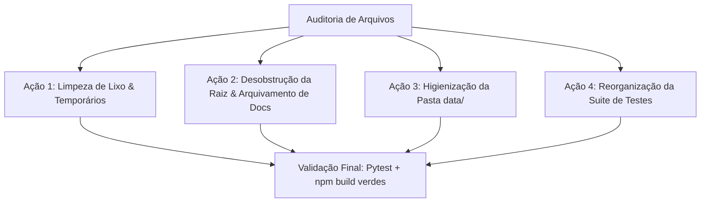

# PLANO DE LIMPEZA, HIGIENIZAÇÃO E REORGANIZAÇÃO DO PROJETO
> **Projeto:** JARVIS AI HUB · **Data:** Novembro de 2026  
> **Objetivo:** Eliminar arquivos obsoletos, remover resíduos de testes e auditorias antigas, desobstruir a raiz e organizar a arquitetura de pastas antes de avançar para novas funcionalidades.

---

## 1. Diagnóstico do Estado Atual (Raio-X de Arquivos Espalhados)

Uma auditoria forense no repositório identificou **mais de 130 arquivos espalhados, temporários ou fora do lugar adequado**:

```
+--------------------------------------------------------------------------------+
|                             ESTADO ATUAL DO REPOSITÓRIO                        |
+--------------------------------------------------------------------------------+
|  [Raiz]              -> 5 arquivos .md/.txt de fases passadas                  |
|                         1 arquivo "jarvis.db" fantasma de 0 bytes              |
|  [data/]             -> 21 arquivos de dumps antigos (evals, benchs, rubricas) |
|                         3 arquivos .bak manuais ocupando ~2 MB                 |
|  [scratch/]          -> 79 arquivos de scripts temporários e logs antigos      |
|  [tmp/]              -> 34 arquivos com bancos de teste e fixtures e2e         |
|  [tests/]            -> 5 testes soltos na raiz da pasta                       |
|                         10 testes com nomes legados (test_frente_01 a 10)      |
|  [dist_installer/]   -> 2 instaladores obsoletos (Beta e v3.0.0) somando ~150MB|
|  [workspace/]        -> 6 diretórios de scaffolds gerados em testes manuais    |
+--------------------------------------------------------------------------------+
```

---

## 2. Ações de Limpeza e Reorganização

O plano é dividido em **4 Ações Cirúrgicas**:



---

### AÇÃO 1: Eliminação de Lixo e Arquivos Descartáveis
Arquivos temporários, logs antigos e artefatos de build que não devem permanecer no repositório:

| Arquivo / Pasta | Tamanho | Motivo do Descarte | Ação |
| :--- | :---: | :--- | :---: |
| `jarvis.db` (na raiz) | 0 B | Arquivo fantasma criado por execução de script na raiz. O banco real está em `data/jarvis.db`. | **Excluir** |
| `dist_installer/JarvisHub-Setup-v0.1-Beta.exe` | 32.7 MB | Instalador beta obsoleto (já substituído pelo `v3.0.1`). | **Excluir** |
| `dist_installer/JarvisHub-Setup-v3.0.0.exe` | 114.4 MB | Instalador anterior obsoleto (já substituído pelo `v3.0.1`). | **Excluir** |
| `scratch/*` (79 arquivos) | ~700 KB | Scripts temporários de auditorias passadas (`audit_*.log`, `audit_*.py`, etc.). | **Excluir** |
| `tmp/e2e/*` (34 arquivos) | ~400 KB | Bancos de dados temporários e tokens gerados em testes Playwright. | **Excluir** |
| `data/jarvis.db.bak` | 483 KB | Backup manual antigo em pasta de runtime. | **Excluir** |
| `data/jarvis.db.preplan.bak*` | 1.1 MB | Backups temporários manuais antigos. | **Excluir** |
| `workspace/test-site-cafe/index.html.bak` | 4.4 KB | Arquivo de backup descartável dentro de workspace. | **Excluir** |
| `apps/dashboard/test-results/` | Variável | Resíduos de execuções locais do Playwright. | **Limpar** |

*Economia de espaço imediata:* **~150 MB** de arquivos desnecessários.

---

### AÇÃO 2: Desobstrução da Raiz e Centralização de Documentos
A raiz do repositório deve conter apenas arquivos de entrada padrão do projeto (`README.md`, configs e scripts principais de inicialização).

| Arquivo Atual (Raiz) | Novo Destino Organizado | Justificativa |
| :--- | :--- | :--- |
| `AVANCO_FASE5_FASE8.md` | `docs/history/AVANCO_FASE5_FASE8.md` | Registro histórico de evolução da Fase 5 à 8. |
| `FECHAMENTO_FASE4_GATE2.md` | `docs/history/FECHAMENTO_FASE4_GATE2.md` | Registro histórico do fechamento do Gate 2. |
| `FECHAMENTO_FASE6_GATE3.md` | `docs/history/FECHAMENTO_FASE6_GATE3.md` | Registro histórico do fechamento do Gate 3. |
| `RELEASE_2.0.md` | `docs/history/RELEASE_2.0.md` | Notas da versão anterior 2.0. |
| `RESUMO_FINAL.txt` | `docs/history/RESUMO_FINAL_2026-11-12.txt` | Registro de auditoria do dia 12/11/2026. |

---

### AÇÃO 3: Higienização da Pasta `data/`
A pasta `data/` deve conter **apenas os bancos e configurações ativas de execução**. Dumps de benchmarks e rubricas antigas devem ser movidos para uma pasta dedicada de arquivo:

* **Criar diretório:** `data/archive/benchmarks/`
* **Mover os 21 arquivos de dumps para lá:**
  * `baseline_agents_test.json`
  * `bench_agents*.json` (3 arquivos)
  * `bench_checks.json`
  * `bench_research_analyst.json`
  * `eval_agents_groq*.json` (7 arquivos)
  * `eval_react_tools.json`
  * `eval_target_*.json` (2 arquivos)
  * `ops_rehearsal.json`
  * `rubrica_*.json` e `rubrica_*.md` (5 arquivos)
* **O que fica na pasta `data/` ativa:**
  * `jarvis.db`, `jarvis.db-wal`, `jarvis.db-shm` (Banco principal)
  * `telemetry.db` (Telemetria)
  * `learning_progress.sqlite3` (Progresso de aprendizado)
  * `api_keys_vault.json` (Cofre de chaves)
  * `hybrid_gateway_config.json` (Configuração do gateway híbrido)
  * `onboarding_state.json` (Estado inicial do onboarding)
  * `auth/` (Credenciais, usuários, dispositivos)
  * `vectors/` (LanceDB - RAG semântico)

---

### AÇÃO 4: Reorganização da Suite de Testes (`tests/`)

#### 4.1 Mover testes soltos na raiz de `tests/`:
* `tests/test_admin_bootstrap.py` $\to` `tests/security/test_admin_bootstrap.py`
* `tests/test_telemetry_store.py` $\to` `tests/unit/test_telemetry_store.py`
* `tests/test_model_auto_selection.py` $\to` `tests/unit/test_model_auto_selection.py`
* `tests/test_model_manager_telemetry.py` $\to` `tests/unit/test_model_manager_telemetry.py`
* `tests/test_model_selector.py` $\to` `tests/unit/test_model_selector.py`

#### 4.2 Renomear os 10 testes de "Frente" para Nomes Orientados a Domínio:
Substituir a nomenclatura de sprints antigas por nomes claros do que o teste realmente valida:

| Nome Antigo | Novo Nome Semântico | Domínio / O que testa |
| :--- | :--- | :--- |
| `test_frente_01.py` | `test_workspace_files_api.py` | Leitura, escrita e abertura de pastas no workspace. |
| `test_frente_02.py` | `test_git_control_and_consensus.py` | Controle de versão git, rollback e mesa redonda de agentes. |
| `test_frente_03.py` | `test_knowledge_vault_rag.py` | Indexação de DOCX/TXT e injeção de contexto RAG. |
| `test_frente_04.py` | `test_hardware_performance_modes.py` | Modos de economia, bateria e warm-up do Ollama. |
| `test_frente_05.py` | `test_project_export_and_docker.py` | Exportação de ZIP limpo, dockerização e webhooks. |
| `test_frente_06.py` | `test_agent_collaboration_network.py` | Rede de comunicação e contratos entre agentes. |
| `test_frente_07.py` | `test_security_cve_and_sandbox.py` | Scanner de vulnerabilidades e isolamento de execução. |
| `test_frente_08.py` | `test_quality_studio_ast_metrics.py` | Métricas de complexidade ciclomática e AST. |
| `test_frente_09.py` | `test_design_studio_wcag_palette.py` | Extração de paleta e contraste WCAG 2.1. |
| `test_frente_10.py` | `test_hybrid_keyvault_resilience.py` | Criptografia do cofre e fallback híbrido de modelos. |

---

### AÇÃO 5: Organização da Pasta `workspace/` (Scaffolds de Amostra)
* Criar a pasta `workspace/samples/`
* Mover os projetos criados em testes manuais (`site-loja`, `site-pizzaria`, `site-seguranca`, `site-vamos`, `test-site-cafe`, `demo_flutter_app`) para `workspace/samples/`, mantendo a raiz do `workspace/` desobstruída para os projetos reais do usuário.

---

## 3. Estrutura Alvo Pós-Limpeza (Clean & Pristine)

```
jarvis-hub/
├── .github/                     # Workflows de CI/CD
├── apps/                        # Aplicações ativas (api, dashboard, desktop, mobile, voice_daemon)
├── data/                        # APENAS dados vivos de runtime (jarvis.db, telemetry.db, auth, vectors)
│   └── archive/benchmarks/      # Dumps históricos arquivados de forma limpa
├── dist_installer/              # Apenas o instalador oficial atual (v3.0.1.exe)
├── docs/                        # Toda documentação centralizada
│   ├── history/                 # Relatórios históricos de fechamento (AVANCO_*, FECHAMENTO_*)
│   ├── architecture/
│   ├── operations/
│   └── PLANO_EVOLUCAO_PRO.md
├── packages/                    # SDKs e bibliotecas internas
├── packaging/                   # Inno Setup e PyInstaller
├── scripts/                     # Scripts de automação e utilitários
├── services/                    # Motores de negócio modulares
├── tests/                       # Suite estruturada sem arquivos soltos
│   ├── unit/                    # Testes unitários puros
│   ├── integration/             # Testes de integração semânticos
│   ├── security/                # Testes de segurança e auth
│   └── e2e/                     # Testes ponta a ponta
├── workspace/                   # Espaço de trabalho limpo
│   └── samples/                 # Exemplos de projetos de demonstração
├── iniciar_jarvis.bat           # Launcher unificado
├── parar_jarvis.bat             # Script de parada
├── package.json                 # Configuração npm workspace
├── pyproject.toml               # Configuração Python
└── README.md                    # Documentação principal
```

---

## 4. Protocolo de Segurança da Limpeza

Para garantir que nenhuma funcionalidade ou teste seja quebrado durante a faxina:
1. **Executar suite de testes antes de mexer em qualquer arquivo** para registrar o baseline 100% verde.
2. **Executar as movimentações e remoções via script automatizado**.
3. **Re-executar a suite de testes completa (`pytest` e `npm run build`)** para certificar que todos os imports e caminhos continuam funcionando sem falhas.
4. **Criar um commit Git atômico** com a mensagem: `refactor(chore): clean repository structure and organize legacy files`.

---

## 5. Próximo Passo

Aprovar a execução deste plano de higienização para deixarmos a base de código 100% limpa e organizada antes de tocar em qualquer nova funcionalidade.
