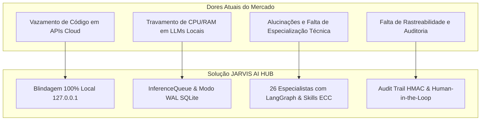

# 🎯 Documento de Visão e Requisitos do Produto (PRD)

> **Projeto**: JARVIS AI HUB  
> **Versão**: 1.0.0 (Release Candidate)  
> **Classificação**: Engenharia de Software Local-First & Governança de IA  
> **Status**: Homologado  

---

## 1. Visão do Produto

O **JARVIS AI HUB** é uma plataforma corporativa e local-first projetada para permitir que desenvolvedores, arquitetos, engenheiros de dados, equipes de cibersegurança e lideranças técnicas utilizem **26 agentes especializados de IA** para analisar, evoluir, documentar e testar codebases complexas existentes, **sem que nenhum dado, código proprietário ou token trafegue para servidores em nuvem sem autorização humana explícita**.

A premissa central é que **modelos de linguagem não devem possuir autoridade externa sobre o sistema anfitrião**: todas as ações de escrita, execução de testes, modificação de arquivos e chamadas de rede externa são estritamente governadas por um motor de políticas (*SecurityCore*), sandboxes determinísticas (*ToolGateway*) e aprovação humana (*ApprovalCenter*).

---

## 2. Personas e Problemas Endereçados

### Personas-Chave:
1. **Engenheiro de Software Sênior & Tech Lead**: Precisa acelerar revisões de código, refatorações de arquitetura limpa (SOLID/DRY) e geração de testes E2E sem comprometer a confidencialidade do repositório da empresa.
2. **Engenheiro de Dados & BI**: Necessita de apoio em modelagem dimensional, pipelines de ETL e indexação SQL de alta performance em bancos SQLite/PostgreSQL.
3. **Auditor de Cibersegurança & SecOps**: Exige visibilidade imediata de CVEs em dependências, análise estática de vulnerabilidades e isolamento estrito de processos.
4. **Gerente de Projetos & CTO**: Requer visibilidade do ROI de produtividade, estimativas de tech debt e relatórios executivos em tempo real sem custos mensais recorrentes em dólar.

---

## 3. Requisitos Funcionais (RF)

| ID | Requisito Funcional | Prioridade | Módulo Responsável |
| :--- | :--- | :---: | :--- |
| **RF-01** | Orquestração de tarefas complexas via grafo direcionado acíclico com suporte a checkpoints e estados persistentes. | P0 (Crítico) | `services/orchestration` |
| **RF-02** | Catálogo e resolução dinâmica de 26 agentes especializados com prompts de sistema enriquecidos. | P0 (Crítico) | `agents/registry` |
| **RF-03** | Fila de inferência com serialização de CPU (`max_concurrent = 1`) para evitar congelamento térmico. | P0 (Crítico) | `services/model_runtime` |
| **RF-04** | Banco de dados relacional e vetorial com modo WAL, cache de 64MB e busy_timeout de 5000ms. | P0 (Crítico) | `services/memory` |
| **RF-05** | Streaming de tokens via Server-Sent Events (SSE) no chat com feedback progressivo dos especialistas. | P0 (Crítico) | `apps/api/routers/chat.py` |
| **RF-06** | Importação de pastas existentes em modo *Read-Only* ou *Read-Write* com branches e worktrees Git isoladas. | P1 (Alto) | `services/project_workspace` |
| **RF-07** | Interceptador *Human-in-the-Loop* com bloqueio absoluto de autoaprovação por agentes de IA. | P0 (Crítico) | `services/security_core` |
| **RF-08** | Base de Conhecimento RAG local para indexação de manuais (PDF, Markdown, código) em blocos semânticos. | P1 (Alto) | `services/knowledge` |
| **RF-09** | Mock Server nativo com rotas coringas `/api/v1/mock/*` e simulação de latência artificial. | P1 (Alto) | `apps/api/routers/studios.py` |
| **RF-10** | SQL Playground com inspeção de esquemas e auditor de performance com `EXPLAIN QUERY PLAN`. | P1 (Alto) | `apps/api/routers/studios.py` |
| **RF-11** | Painel de controle de telemetria com monitorização instantânea de CPU, RAM, GPU e bateria. | P1 (Alto) | `apps/api/routers/hardware.py` |
| **RF-12** | Console de logs em tempo real via SSE com filtros por severidade e busca contextual. | P1 (Alto) | `apps/api/routers/system.py` |

---

## 4. Requisitos Não Funcionais (RNF)

* **RNF-01 (Confinamento Local)**: Todos os serviços backend devem vincular-se estritamente à interface de loopback `127.0.0.1`, rejeitando conexões externas não tuneladas por VPN privada (Tailscale).
* **RNF-02 (Desempenho de Leitura)**: O banco de dados deve sustentar mais de 150 requisições concorrentes por segundo com latência média inferior a 100ms em modo WAL.
* **RNF-03 (Desempenho de Escrita)**: O sistema de concorrência deve suportar pelo menos 200 escritas simultâneas por segundo sem apresentar erros de *database locked*.
* **RNF-04 (Hardware Notebook)**: O sistema deve operar de maneira fluida em hardware de referência (Intel Core i5 de 4 núcleos/8 threads, 32 GB RAM, SSD, gráficos integrados).
* **RNF-05 (Segurança & Sanitização)**: Todas as mensagens e logs devem passar por algoritmo de redaction que detecta e mascara credenciais (`sk-...`, tokens JWT, senhas e chaves privadas).
* **RNF-06 (Interface em Português do Brasil)**: 100% dos textos, rótulos, badges e alertas visíveis na interface devem ser apresentados em Português do Brasil claro, sem exposição de identificadores técnicos crus em *snake_case*.
* **RNF-07 (Responsividade Visual)**: A interface web SPA deve adaptar-se perfeitamente de telas de smartphones (360px) a monitores Ultrawide (3840px), utilizando CSS Grid com `minmax(min(100%, Xpx), 1fr)`.
