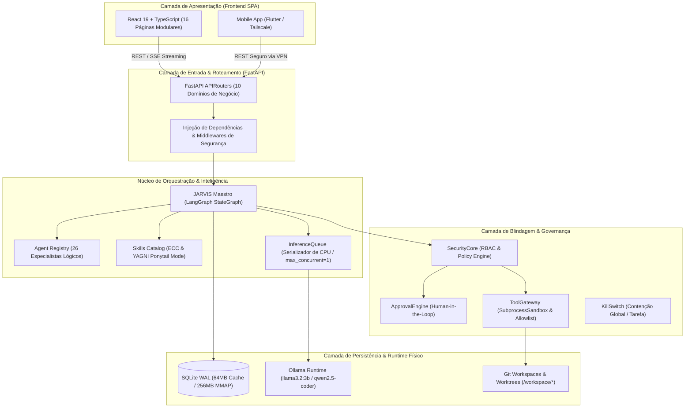
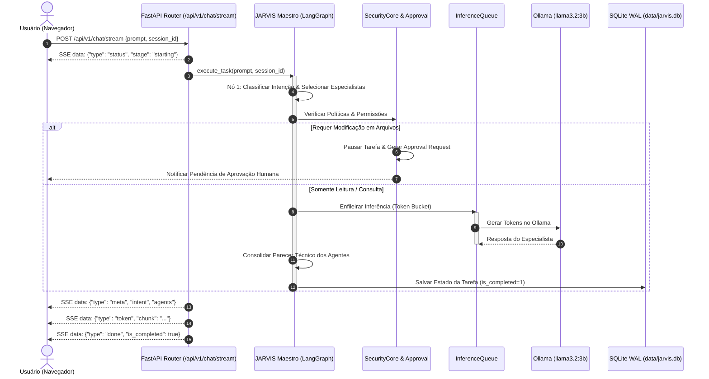
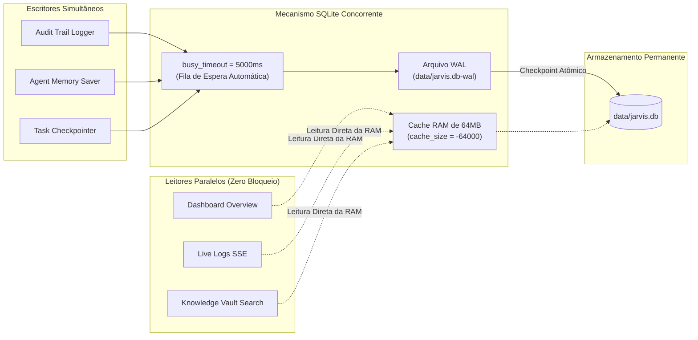

# 🏗️ Diagrama de Arquitetura e Fluxos de Dados

> **Projeto**: JARVIS AI HUB  
> **Versão**: 1.0.0  
> **Padrão**: Monólito Modular, Clean Architecture & Local-First  

---

## 1. Visão Geral da Arquitetura do Sistema

O JARVIS AI HUB adota uma arquitetura em **Monólito Modular** dividida em camadas lógicas bem definidas, garantindo desacoplamento estrito, alta velocidade de comunicação interna em memória e facilidade de manutenção.

---

## 2. Fluxo de Execução de Tarefas (Chat & Deliberação Multi-Agente)

O ciclo de vida de uma requisição de chat é governado pelo **LangGraph StateGraph**, garantindo rastreabilidade, integridade de estado e tratamento de exceções com fallback heurístico.

---

## 3. Fluxo de Dados de Persistência com SQLite WAL & Concorrência

Para permitir que múltiplas operações de leitura ocorram simultaneamente com gravações de auditoria e memórias, o SQLite foi ajustado com modo WAL (*Write-Ahead Logging*):

---

## 4. Estrutura de Camadas Clean Architecture

O código segue estritamente a separação de responsabilidades em anéis concêntricos:

1. **Entidades & Contratos (`packages/contracts`)**:
   - Modelos Pydantic imutáveis (`AgentRole`, `TaskState`, `AgentOutputContract`, `ApprovalRequest`).
   - Totalmente desacoplados de qualquer framework web ou banco de dados.
2. **Casos de Uso & Serviços (`services/*`)**:
   - `services/orchestration`: Orquestração de grafos LangGraph.
   - `services/security_core`: Motor de regras, RBAC, HMAC e Kill Switch.
   - `services/model_runtime`: Gerenciamento de ciclo de vida de LLMs e fila de concorrência.
   - `services/project_workspace`: Varredura, inventário e manipulação de árvores Git.
3. **Adaptadores de Interface (`apps/api/routers/*`)**:
   - Controladores FastAPI desacoplados em 10 domínios que convertem HTTP/SSE para invocações de serviços.
4. **Infraestrutura Externa (`services/memory/database.py`, `services/tool_gateway/sandbox.py`)**:
   - Drivers SQLite, subprocessos do sistema operacional e clientes de rede local.
