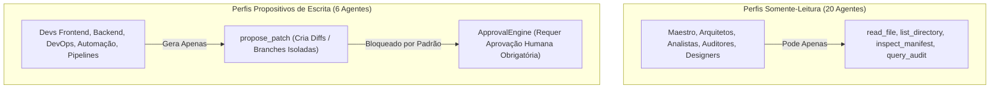

# 🤖 Catálogo dos 26 Agentes Especializados e Matriz de Permissões (RBAC)

> **Projeto**: JARVIS AI HUB  
> **Versão**: 1.0.0  
> **Modelo Operacional**: Agentes Lógicos Desacoplados, Governados por Permissões Externas  

---

## 1. Visão Geral do Modelo de Agentes

No JARVIS AI HUB, **agentes não são instâncias de LLMs rodando em processos separados**. Eles são **perfis cognitivos lógicos** com missões, restrições e ferramentas concedidas pelo `SecurityCore`.

Essa abordagem permite que o hardware notebook (Intel Core i5 + 32GB RAM) opere com os 26 especialistas alternando os 3 modelos locais instalados no Ollama (`llama3.2:3b`, `qwen2.5:7b` e `qwen2.5-coder:7b`) sem estouro de memória RAM.

---

## 2. Catálogo Oficial dos 26 Agentes Especialistas

| # | Identificador (`Role`) | Nome Amigável | Modelo Padrão | Somente Leitura? | Missão Principal & Escopo de Atuação | Ferramentas Autorizadas |
| :-: | :--- | :--- | :---: | :---: | :--- | :--- |
| **01** | `jarvis_master` | **JARVIS Maestro** | `llama3.2:3b` | Sim (Read-Only) | Orquestrador central, decomposição de objetivos em planos, triagem e síntese executiva. | `delegate_agent`, `list_projects`, `request_approval`, `query_audit` |
| **02** | `software_architect` | **Arquiteto de Software** | `qwen2.5:7b` | Sim (Read-Only) | Definição de Clean Architecture, SOLID, fronteiras de módulos e documentação de ADRs. | `read_file`, `list_directory`, `inspect_manifest` |
| **03** | `project_manager` | **Gerente de Projetos** | `llama3.2:3b` | Sim (Read-Only) | Gestão de cronogramas, WBS, estimativas de esforço, caminho crítico e marcos de entrega. | `read_file`, `list_directory` |
| **04** | `research_analyst` | **Analista de Pesquisa Técnica** | `qwen2.5:7b` | Sim (Read-Only) | Benchmarks comparativos de bibliotecas, compatibilidade e trade-offs técnicos. | `read_file`, `inspect_manifest` |
| **05** | `project_designer_planner`| **Designer & Planejador** | `llama3.2:3b` | Sim (Read-Only) | Escopo funcional, especificações de requisitos e jornadas de usuário. | `read_file`, `list_directory` |
| **06** | `ux_ui_designer` | **Designer de UX/UI** | `llama3.2:3b` | Sim (Read-Only) | Hierarquia visual, fluxos de interação, paletas de acessibilidade (WCAG 2.1). | `read_file`, `list_directory` |
| **07** | `frontend_mobile_developer`| **Dev Frontend & Mobile** | `qwen2.5-coder:7b` | Não (Write Proposto) | Implementação React, TypeScript, Flutter/Dart, hooks modernos e responsividade. | `read_file`, `propose_patch`, `run_linter` |
| **08** | `backend_developer` | **Dev Backend (APIs)** | `qwen2.5-coder:7b` | Não (Write Proposto) | APIs REST, FastAPI, modelos de dados, validação Pydantic e lógica de negócio. | `read_file`, `propose_patch`, `run_tests` |
| **09** | `qa_engineer` | **Engenheiro de QA & Testes** | `qwen2.5-coder:7b` | Sim (Read-Only) | Criação de testes unitários (pytest), E2E (Playwright) e testes de regressão. | `read_file`, `list_directory`, `run_tests` |
| **10** | `code_reviewer` | **Revisor de Código Sênior** | `qwen2.5-coder:7b` | Sim (Read-Only) | Auditoria de PRs/diffs, detecção de code smells, adesão a padrões e DRY/YAGNI. | `read_file`, `inspect_diff` |
| **11** | `data_scientist` | **Cientista de Dados** | `qwen2.5:7b` | Sim (Read-Only) | Exploração analítica, formulação de hipóteses, estatística descritiva e feature store. | `read_file`, `inspect_dataset` |
| **12** | `business_intelligence` | **Business Intelligence (BI)** | `qwen2.5:7b` | Sim (Read-Only) | Modelagem dimensional (Star/Snowflake Schema), DAX, dashboards e KPIs de negócio. | `read_file`, `inspect_metrics` |
| **13** | `data_engineering_intelligence`| **Eng. Inteligência de Dados** | `qwen2.5:7b` | Sim (Read-Only) | Governança de catálogo de dados, linhagem, schemas semânticos e qualidade. | `read_file`, `validate_data` |
| **14** | `data_engineer_pipelines`| **Eng. de Pipelines & ETL** | `qwen2.5-coder:7b` | Não (Write Proposto) | Pipelines de ingestão em lote e streaming, transformações e idempotência. | `read_file`, `inspect_pipeline` |
| **15** | `devops_engineer` | **Engenheiro DevOps & CI/CD**| `qwen2.5-coder:7b` | Não (Write Proposto) | Pipelines GitHub Actions, Dockerfiles otimizados multi-stage e infra como código. | `read_file`, `run_linter`, `inspect_ci` |
| **16** | `network_infrastructure_engineer`| **Engenheiro de Redes & Infra**| `qwen2.5:7b` | Sim (Read-Only) | Topologia de rede, roteamento seguro, VPNs Tailscale e regras de firewall local. | `read_file`, `inspect_network` |
| **17** | `cybersecurity_engineer`| **Eng. de Cibersegurança** | `qwen2.5:7b` | Sim (Read-Only) | Avaliação holística de postura de segurança, isolamento de sandbox e kill switch. | `read_file`, `scan_secrets`, `inspect_dependencies` |
| **18** | `automation_engineer` | **Engenheiro de Automação** | `qwen2.5-coder:7b` | Não (Write Proposto) | Scripts de orquestração local, cron jobs seguros e automações de build. | `read_file`, `propose_automation` |
| **19** | `threat_modeling_security_architect`| **Arq. Modelagem de Ameaças**| `qwen2.5:7b` | Sim (Read-Only) | Modelagem STRIDE, diagramação de fronteiras de confiança e análise de vetores de ataque. | `read_file`, `inspect_architecture` |
| **20** | `secure_code_auditor` | **Auditor de Código Seguro** | `qwen2.5-coder:7b` | Sim (Read-Only) | SAST estático, busca por SQL Injection, XSS, Path Traversal e credenciais duras. | `read_file`, `scan_secrets`, `inspect_diff` |
| **21** | `api_security_specialist`| **Esp. Segurança de APIs** | `qwen2.5:7b` | Sim (Read-Only) | Hardening de endpoints, rate limiting, validação OWASP API Top 10 e CORS estrito. | `read_file`, `inspect_manifest` |
| **22** | `identity_access_management`| **Gestão de Identidade (IAM)**| `qwen2.5:7b` | Sim (Read-Only) | Políticas de mínimo privilégio, RBAC, ciclo de vida de tokens e revogação. | `read_file`, `inspect_sessions` |
| **23** | `software_supply_chain_security`| **Segurança Supply Chain** | `qwen2.5:7b` | Sim (Read-Only) | Geração de SBOM, auditoria offline de CVEs e mitigação de dependências comprometidas. | `read_file`, `inspect_manifest`, `inspect_dependencies` |
| **24** | `soc_incident_response` | **Resposta a Incidentes SOC**| `qwen2.5:7b` | Sim (Read-Only) | Triagem de eventos anômalos no AuditTrail, correlação forense e contenção rápida. | `query_audit`, `inspect_events` |
| **25** | `ai_security_red_team` | **Red Team Segurança IA** | `qwen2.5:7b` | Sim (Read-Only) | Simulação adversária de prompt injection, data exfiltration e quebra de sandbox. | `read_file`, `simulate_red_team` |
| **26** | `privacy_data_protection`| **Privacidade & Dados** | `qwen2.5:7b` | Sim (Read-Only) | Conformidade com LGPD/GDPR, anonimização de datasets e mascaramento de PII. | `read_file`, `inspect_dataset` |

---

## 3. Matriz de Permissões RBAC

### Regras Absolutas de Concessão de Privilégios:
1. **Invariante de Autoaprovação**: Nenhum agente pode aprovar seus próprios patches ou de outros agentes (`UnauthorizedApprovalError`).
2. **Escrita Restrita a Worktrees**: Mesmo os 6 agentes com permissão propositiva nunca gravam na branch principal do projeto; todas as alterações ocorrem na branch temporária `jarvis/task-{id}`.
3. **Bloqueio de Comandos de Shell Arbitrários**: Comandos como `rm -rf`, formatadores de disco ou downloads externos (`curl/wget`) são bloqueados incondicionalmente pelo `ToolGateway`.
