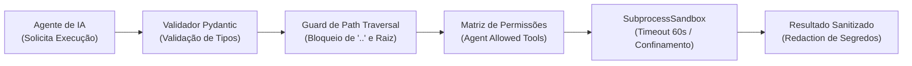

# 🛠️ Catálogo de Ferramentas e Schemas (ToolGateway)

> **Projeto**: JARVIS AI HUB  
> **Versão**: 1.0.0  
> **Camada**: `services/tool_gateway`  

---

## 1. Visão Geral do ToolGateway

O **ToolGateway** é a barreira física que isola a execução de comandos do sistema operacional contra acessos não autorizados por parte dos agentes de IA. Nenhum comando de terminal ou leitura de disco ocorre sem passar pela validação de esquema, sandbox e verificação de políticas do `SecurityCore`.



---

## 2. Catálogo Oficial de Ferramentas Permitidas

| Nome da Ferramenta | Categoria | Descrição | Requer Aprovação? | Timeout |
| :--- | :--- | :--- | :---: | :---: |
| `read_file` | `READ_ONLY` | Lê o conteúdo textual de arquivos dentro do projeto autorizado. | Não | 10s |
| `list_directory` | `READ_ONLY` | Enumera recursivamente arquivos e pastas respeitando `.gitignore`. | Não | 15s |
| `search_code` | `SEARCH` | Realiza buscas rápidas por texto exato ou expressões regulares nos arquivos. | Não | 20s |
| `git_status` | `GIT_READ` | Consulta o status de modificações da árvore de trabalho Git. | Não | 10s |
| `git_diff` | `GIT_READ` | Inspeciona o diff unificado entre branches ou o estado atual da tarefa. | Não | 15s |
| `run_tests` | `TEST_RUNNER` | Executa a suíte de testes (`pytest`, `flutter test`, `npm test`) em sandbox isolada. | Condicional | 60s |
| `run_linter` | `LINTER` | Executa analisadores estáticos (`ruff`, `flake8`, `eslint`, `flutter analyze`). | Não | 45s |
| `propose_patch` | `WORKSPACE_MODIFY`| Prepara alterações de código em branch isolada `jarvis/task-{id}`. | **SIM** | 30s |
| `query_audit` | `AUDIT` | Consulta eventos e trilhas forenses no banco de dados local. | Não | 10s |

---

## 3. Schemas de Entrada e Saída (Contratos de Dados)

### 3.1. Ferramenta: `read_file`
```python
class ReadFileInput(BaseModel):
    file_path: str = Field(
        ..., description="Caminho relativo do arquivo em relação à raiz do projeto."
    )
    max_lines: int = Field(500, description="Limite máximo de linhas para leitura segura.")
    byte_offset: int = Field(0, description="Offset para paginação em arquivos extensos.")


class ReadFileOutput(BaseModel):
    content: str
    lines_read: int
    total_lines: int
    truncated: bool
```

### 3.2. Ferramenta: `run_tests`
```python
class RunTestsInput(BaseModel):
    project_id: str = Field(..., description="Identificador do projeto registrado.")
    test_suite: Literal["pytest", "flutter", "npm"] = Field("pytest")
    target_path: Optional[str] = Field(None, description="Arquivo ou pasta de testes específica.")


class RunTestsOutput(BaseModel):
    is_success: bool
    exit_code: int
    duration_seconds: float
    summary: dict[str, int]  # {"total": 35, "passed": 35, "failed": 0, "skipped": 0}
    stdout: str
    stderr: str
```

### 3.3. Ferramenta: `propose_patch` (Escrita Proposta)
```python
class ProposePatchInput(BaseModel):
    task_id: str
    target_file: str
    unified_diff: str
    justification: str


class ProposePatchOutput(BaseModel):
    branch_name: str  # "jarvis/task-ab37e221"
    approval_required: bool = True
    approval_id: str
    status: str  # "awaiting_human_approval"
```

---

## 4. Algoritmos de Proteção e Sandbox

1. **Prevenção de Path Traversal**:
   ```python
   def sanitize_path(base_dir: Path, requested_path: str) -> Path:
       resolved = (base_dir / requested_path).resolve()
       if not str(resolved).startswith(str(base_dir.resolve())):
           raise PermissionDeniedError("Tentativa de escape de diretório raiz detectada.")
       return resolved
   ```
2. **SubprocessSandbox com Timeout de 60s**:
   - Processos de teste e linters são executados em subprocessos monitorados.
   - Caso um teste entre em loop infinito ou exceda 60 segundos, o processo e sua árvore de subprocessos são encerrados forçadamente via `SIGKILL` / `TerminateProcess`, registrando alerta no `AuditTrail`.
