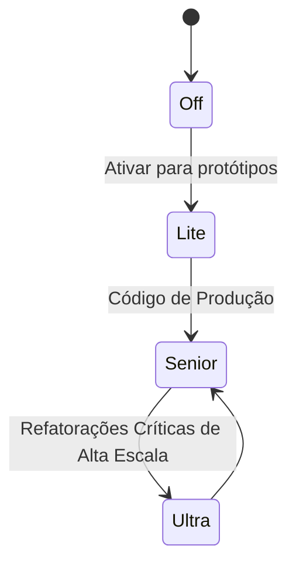

# 🧠 Catálogo de Skills, Licenças, Origens e Versões

> **Projeto**: JARVIS AI HUB  
> **Versão**: 1.0.0  
> **Camada**: `services/skills_manager` e `skills/*`  

---

## 1. Visão Geral do Sistema de Skills

As **Skills** no JARVIS AI HUB representam blocos de conhecimento procedimental, padrões arquiteturais e metodologias injetadas dinamicamente nos agentes especializados. Ao contrário de modelos finetunados estáticos, as skills são versionadas em JSON/YAML e validadas criptograficamente com **SHA-256** antes de cada execução.

---

## 2. Catálogo de Skills Internas (Padrão ECC — Enterprise Cognitive Competencies)

As competências ECC garantem rigor de engenharia de software sênior para tarefas corporativas:

| Identificador da Skill | Nome da Competência | Origem / Fonte | Licença | Versão | Nível Ponytail Recomendado |
| :--- | :--- | :--- | :---: | :---: | :---: |
| `ecc_clean_architecture` | Clean Architecture & SOLID | Nativa (JARVIS Core) | MIT | 1.2.0 | Senior / Ultra |
| `ecc_api_rest_design` | Design de APIs RESTful e OpenAPI | Nativa (JARVIS Core) | MIT | 1.1.0 | Lite / Senior |
| `ecc_threat_modeling_stride`| Modelagem de Ameaças STRIDE | OWASP / SecurityCore | Apache 2.0 | 1.0.0 | Senior |
| `ecc_tdd_workflows` | Fluxos de TDD & Testes Automatizados | Martin Fowler / Agile | MIT | 1.0.0 | Senior |
| `ecc_flutter_bloc_architecture`| Arquitetura BLoC em Flutter | Flutter Community | MIT | 1.3.0 | Senior |
| `ecc_react_modern_hooks` | React 19 Modern Hooks & Concurrency | React Core Team | MIT | 1.2.0 | Lite / Senior |
| `ecc_docker_containerization`| Docker Multi-stage & Segurança | Docker Best Practices | Apache 2.0 | 1.1.0 | Senior |
| `ecc_sql_indexing_tuning` | Indexação SQL e Otimização WAL | SQLite / Postgres Docs | MIT | 1.4.0 | Ultra |
| `ecc_data_pipeline_etl` | Pipelines de Dados e Idempotência | DataOps Institute | MIT | 1.0.0 | Senior |
| `ecc_prompt_injection_defense`| Blindagem Contra Prompt Injections | OWASP Top 10 LLM | Apache 2.0 | 1.2.0 | Ultra |
| `ecc_privacy_data_minimization`| Minimização de Dados (LGPD/GDPR) | IAPP Frameworks | Apache 2.0 | 1.0.0 | Senior |
| `ecc_supply_chain_sbom` | Auditoria de Dependências e SBOM | CISA Guidelines | Apache 2.0 | 1.0.0 | Senior |
| `ecc_incident_root_cause_analysis`| Análise de Causa Raiz de Incidentes | SRE Google Handbook | CC-BY-4.0 | 1.1.0 | Senior |
| `ecc_git_conventional_commits`| Commits Semânticos e Git Flow | Conventional Commits | MIT | 1.0.0 | Lite |

---

## 3. Catálogo de Skills Importadas e Versionadas

| Arquivo da Skill | Domínio Técnico | Origem do Repositório | Licença |
| :--- | :--- | :--- | :---: |
| `devops_ci_cd_git.json` | DevOps e automação CI/CD | GitHub Actions Templates | MIT |
| `fastapi_secure_backend.json` | Padrões de segurança em FastAPI | FastAPI Official Security Docs | MIT |
| `flutter_clean_architecture.json` | Separação de camadas no mobile | Reso Coder Clean Arch | MIT |
| `owasp_code_audit.json` | Auditoria de vulnerabilidades comuns | OWASP Foundation | Apache 2.0 |
| `prd_planning_management.json` | Especificação funcional de requisitos | Silicon Valley Product Group | MIT |
| `react_typescript_components.json`| Componentização modular e tipagem | TypeScript Guidelines | MIT |
| `sql_data_modeling.json` | Modelagem relacional e normalização | Kimball Group | MIT |

---

## 4. O Modo Ponytail (Injeção de Rigor YAGNI & DRY)

O **Modo Ponytail** é um interceptador cognitivo configurável no painel que força os agentes a aderirem a princípios estritos de simplicidade e sustentabilidade de código:

* **Desativado (`Off`)**: Respostas diretas sem exigência explícita de justificativas arquiteturais.
* **Leve (`Lite`)**: Incentiva funções pequenas e modularização básica.
* **Sênior (`Senior` - Padrão)**: Exige justificativa formal para cada nova dependência instalada, proíbe duplicação de lógica (DRY) e impõe tipagem estrita.
* **Ultra (`Ultra`)**: Bloqueia categoricamente bibliotecas desnecessárias (*You Aren't Gonna Need It*), exige complexidade ciclomática baixa e gera relatórios de dívida técnica antes de qualquer patch.

---

## 5. Validação de Integridade Criptográfica (SHA-256)

Para evitar que skills sejam adulteradas maliciosamente no disco local:
1. Toda skill possui um hash SHA-256 pré-calculado em manifesto seguro.
2. O `SkillsManager` calcula o hash do arquivo JSON antes do carregamento.
3. Se o hash for divergente, o carregamento é rejeitado imediatamente com `TamperedSkillError` e um alerta de segurança é gerado.
