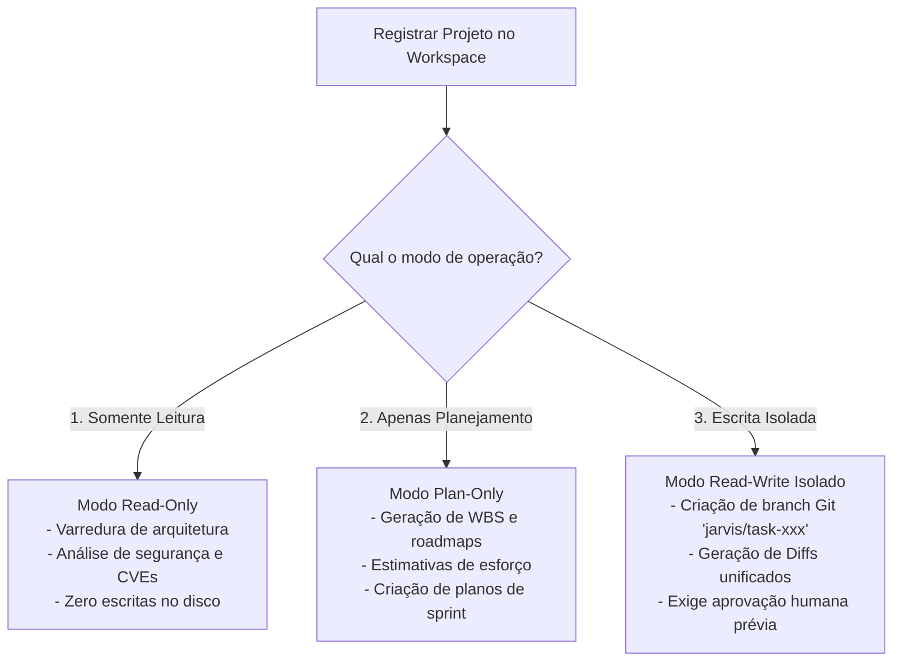
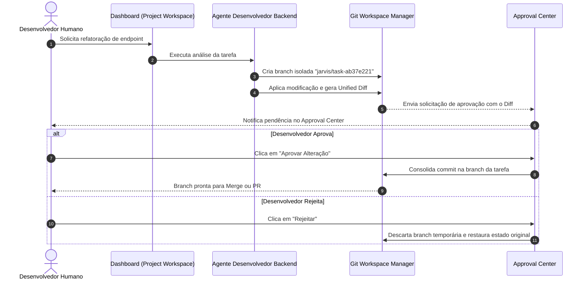

# 📁 Manual do Project Workspace e Fluxo de Trabalho Git

> **Projeto**: JARVIS AI HUB  
> **Versão**: 1.0.0  
> **Serviço**: `services/project_workspace`  

---

## 1. Visão Geral do Project Workspace

O módulo **Project Workspace** permite que o usuário aponte qualquer pasta de código existente no computador (ex: Flutter, React, FastAPI, Node, Go, Java, .NET) e autorize o JARVIS AI HUB a analisar e propor evoluções arquiteturais.

A integridade do código original é o pilar número um: **nenhum agente pode sobrescrever arquivos diretamente na sua branch de trabalho sem aprovação prévia**.

---

## 2. Modos de Operação do Projeto

Ao registrar um projeto, você escolhe entre três modos de proteção estrita:

1. **Modo Somente Leitura (`READ_ONLY`)**:
   - Padrão recomendado para auditorias iniciais e relatórios executivos.
   - O `SecurityCore` intercepta e bloqueia qualquer tentativa de escrita em nível de kernel (`PermissionDeniedError`).

2. **Modo Apenas Planejamento (`PLAN_ONLY`)**:
   - Os agentes de Produto e Arquitetura decompõem os requisitos em tarefas e diagramas sem alterar o código-fonte.

3. **Modo Escrita Isolada (`READ_WRITE_ISOLATED`)**:
   - Utilizado quando os desenvolvedores solicitam correções de bugs ou refatorações aos agentes.
   - O JARVIS cria uma branch Git temporária dedicada (`jarvis/task-{task_id}`) para isolar o trabalho.

---

## 3. Fluxo de Trabalho Git e Aprovação Humana (Human-in-the-Loop)

---

## 4. Operações Práticas no Painel Web

### 4.1. Importar Nova Pasta de Projeto
1. Acesse o menu **Workspace & Projetos** no dashboard.
2. Clique no botão **"Importar Pasta Local"**.
3. Informe o identificador do projeto (ex: `meu-app-mobile`) e o caminho absoluto (ex: `C:\Projetos\meu-app-mobile`).
4. Selecione o modo de operação e clique em **Registrar Projeto**.

### 4.2. Exportar Backup em Arquivo ZIP
1. No cartão do projeto, localize o botão com ícone de arquivo compactado.
2. O JARVIS gerará instantaneamente um arquivo ZIP limpo do projeto (ignorando automaticamente `node_modules`, `.venv`, `.git` e artefatos de build), pronto para download seguro.

### 4.3. Visualização de Arquivos e Diffs
* Utilize o botão **"Ver Arquivos"** para navegar na árvore de diretórios do projeto sem sair do navegador.
* No **Approval Center**, visualize os diffs com destaque de sintaxe em cores (verde para adições, vermelho para remoções) antes de autorizar qualquer mesclagem.
