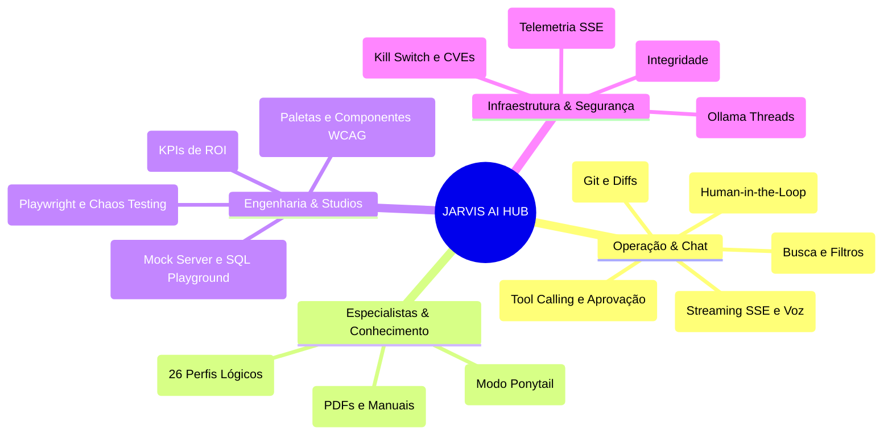
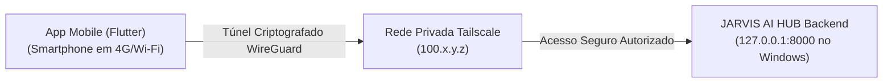

# 📱 Manual do Dashboard Web e Aplicativo Mobile

> **Projeto**: JARVIS AI HUB  
> **Versão**: 1.0.0  
> **Interfaces**: Web SPA (React 19 + TypeScript) & Mobile App (Flutter)  

---

## 1. Visão Geral do Dashboard Web

O **Dashboard Web** é o centro de comando do desenvolvedor, projetado com tema escuro moderno (*dark mode*), visualização de alta densidade e **17 páginas/estúdios modulares** totalmente responsivos:

---

## 2. Guia de Funcionalidades por Página

### 2.1. Chat Master (Comunicação Central com Streaming)
* **Motor de conversa**: Por padrão (`engine: auto`), conversas usam o runtime real com memória e streaming token a token. Ações de código, criação de projeto e rollback continuam no orquestrador para preservar aprovações humanas. O campo aceita `auto`, `agent` ou `orchestrator`.
* **Memória por sessão**: As últimas 40 mensagens são enviadas ao modelo e cada turno é persistido em `chat_messages`, inclusive quando a resposta vem do orquestrador.
* **Visualização Progressiva de Tokens**: As respostas do LLM são transmitidas caractere a caractere via SSE (`/api/v1/chat/stream`).
* **Comandos Rápidos no Chat**:
  * `/ponytail [off|lite|senior|ultra]`: Ajusta instantaneamente o rigor YAGNI/DRY na resposta.
  * `/debate [tema]`: Inicia deliberação conjunta entre o Arquiteto e o Auditor de Segurança.
  * `/rollback`: Solicita o descarte de alterações não aprovadas.
* **Histórico de Sessões**: Gaveta lateral acessível com recuperação de conversas passadas e botão de exclusão limpa.

### 2.2. Paleta de Comandos Global (`Ctrl + K`)
* Pressione `Ctrl + K` em qualquer tela para abrir a busca universal.
* Digite para navegar rapidamente para qualquer projeto, agente ou página do hub.

### 2.3. Studios de Engenharia
* **Backend Studio**: Crie endpoints simulados em segundos com código de status e latência customizados (`/api/v1/mock/*`). Inspecione tabelas SQLite e audite consultas com `EXPLAIN QUERY PLAN`.
* **Quality Studio**: Descubra suítes de testes existentes, gere scripts E2E Playwright prontos para colar e simule cenários de Chaos Testing.
* **Design Studio**: Escolha paletas com conformidade WCAG 2.1 AAA e visualize componentes visuais renderizados.
* **Relatório Executivo**: Visualize a economia financeira acumulada em comparação ao uso de APIs pagas em dólar, gere resumos em Markdown e imprima relatórios para a diretoria.

### 2.4. Coding Agent (Agente de Código com Ferramentas Reais)
* **Loop de Tool Calling**: O agente lê, pesquisa, edita e executa comandos em ciclo, com até 12 iterações por execução e timeout global configurável.
* **Seleção de Modo**:
  * `plan`: somente leitura — ferramentas de escrita e execução não são enviadas ao modelo.
  * `ask`: pausa antes de cada escrita ou comando e exige aprovação humana.
  * `auto`: executa direto no sandbox, mantendo os bloqueios duros de segurança.
* **Aprovação Human-in-the-Loop**: Cada operação crítica exibe diff unificado, recurso afetado e permite aprovar ou recusar. Agentes nunca podem autoaprovar.
* **Ferramentas Disponíveis**: `read_file`, `list_directory`, `glob`, `grep`, `write_file`, `edit_file`, `run_command`, `git_status`, `git_diff` e `git_commit`.
* **Git com Aprovação**: O `git_commit` usa mensagem sanitizada, exclui backups `.bak` do commit e só executa após aprovação humana no modo `ask`.
* **Ferramentas MCP**: Configure servidores em `data/mcp_servers.json` e use **Recarregar MCP** na tela para descobrir ferramentas externas como `mcp__<servidor>__<ferramenta>`.
* **Histórico Persistido**: Cada mensagem, chamada e resultado é gravado por sessão (`/api/v1/coding/sessions/{id}/messages`) e pode ser limpo pela interface.
* **API SSE**: Eventos `start`, `thinking`, `assistant`, `tool_call`, `tool_result`, `approval_required`, `final` e `error` em `/api/v1/coding/run/stream`.
* **Navegação por URL**: O dashboard usa rotas reais (`/chat`, `/coding`, `/agents`...), com suporte a voltar/avançar e ao formato legado `?tab=`. Cada tela é carregada sob demanda.

---

## 3. Conexão Remota Segura via Aplicativo Mobile (Flutter)

O JARVIS AI HUB permite acompanhamento de tarefas e **aprovação de patches na palma da mão**, mesmo longe do computador, utilizando uma rede privada virtual (**Tailscale VPN**) com confinamento estrito.

### Passo a Passo de Pareamento Mobile:

1. **Instalar o Tailscale**:
   * Instale o Tailscale no computador Windows e no smartphone (Android ou iOS) e faça login na mesma conta.
2. **Obter o IP Privado do Computador**:
   * Anote o endereço IP do Tailscale do computador (ex: `100.85.120.45`).
3. **Configurar o App Mobile**:
   * Abra o aplicativo JARVIS Mobile no smartphone.
   * No campo de endereço do servidor, informe: `http://100.85.120.45:8000`.
   * Clique em **"Conectar ao Hub"**.
4. **Funcionalidades no Smartphone**:
   * Recebimento de notificações push para aprovação de código.
   * Visualização de diffs em tela cheia com botão de **Aprovar** e **Rejeitar**.
   * Acompanhamento dos logs do servidor e acionamento do **Kill Switch** de emergência.
