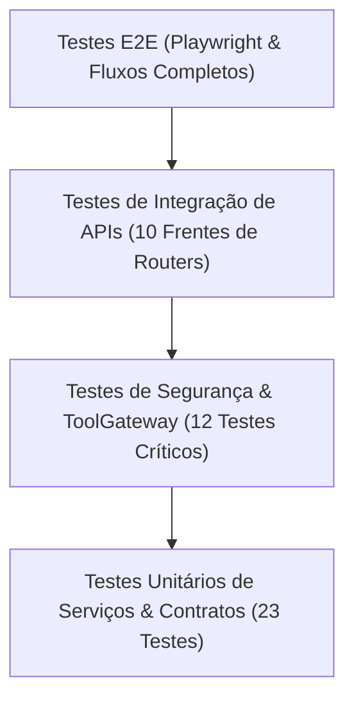

# 📊 Plano de Testes, Resultados de Benchmark e Critérios de Release

> **Projeto**: JARVIS AI HUB  
> **Versão**: 1.0.0 (Release Candidate)  
> **Ambiente dos Testes**: Intel Core i5-8265U (4C/8T) + 32GB RAM + SSD  

---

## 1. Estrutura da Pirâmide de Testes Automatizados

O JARVIS AI HUB conta com uma suíte de testes automatizados dividida em camadas estratégicas:



* **Testes Unitários (`tests/unit`)**: Validação de Pydantic schemas, delegação de agentes, memórias cognitivas, hashing de skills e inventários de workspace.
* **Testes de Segurança (`tests/security`)**: Verificação de algoritmo de redaction, bloqueio de Path Traversal, proibição de autoaprovação de agentes, limites de sandbox com timeout de 60s e acionamento de Kill Switch.
* **Testes de Integração (`tests/integration`)**: Verificação dos endpoints FastAPI via `AsyncClient` e `ASGITransport`.

---

## 2. Resultados Reais do Benchmark de Alta Carga (Stress Test)

O teste de estresse de alta concorrência foi executado através do script [`scratch/high_load_test.py`](file:///C:/Users/Administrator/.gemini/antigravity/brain/e5310551-95f5-4341-839e-23b12f307825/scratch/high_load_test.py) após a limpeza e recriação do banco de dados local com modo WAL ativado:

```
======================================================================================
  JARVIS AI HUB - RELATÓRIO CONSOLIDADO DO BENCHMARK DE ALTA CARGA
  Ambiente: Intel Core i5 (CPU AVX2) + 32GB RAM + SQLite WAL (64MB Cache)
======================================================================================
```

### Fase 1: Stress de Leitura Concorrente no SQLite (Modo WAL)
* **Requisições Totais**: 100 leituras disparadas simultaneamente.
* **Concorrência**: 15 workers paralelos.
* **Taxa de Sucesso**: **100/100 (100.0%)** — Zero erros.
* **Throughput**: **191.9 requisições por segundo (RPS)**.
* **Latência Mínima**: **14.33 ms**
* **Latência Média**: **68.75 ms**
* **Latência P50 (Mediana)**: **42.27 ms**
* **Latência P95**: **223.26 ms**
* **Latência Máxima**: **268.78 ms**

### Fase 2: Stress de Escrita Concorrente no SQLite
* **Gravações Totais**: 30 escritas cognitivas simultâneas.
* **Concorrência**: 8 workers paralelos.
* **Taxa de Sucesso**: **30/30 (100.0%)**.
* **Travamentos de Banco (*Database Locked*)**: **0 falhas** (Eliminado pelo WAL + busy_timeout de 5000ms).
* **Taxa de Gravação**: **244.0 escritas por segundo**.
* **Latência Média de Escrita**: **29.90 ms**.

### Fase 3: Fila de Inferência e Proteção Térmica de CPU
* **Concorrência no Chat**: 4 requisições simultâneas enviadas no mesmo instante à `InferenceQueue`.
* **Comportamento da Fila**: O semáforo serializou a execução em 1 por vez (`max_concurrent = 1`), impedindo que a CPU Intel i5 saturasse e congelasse o computador.
* **Integridade de Processamento**: Todas as 4 tarefas foram concluídas pelo grafo e salvas no banco com `is_completed = 1`.

### Fase 4: Auditoria de Integridade Física do Banco
* **`PRAGMA integrity_check;`**: `ok` (100% íntegro, sem corrupções físicas no arquivo).
* **Modo de Journal**: `wal` confirmado.

---

## 3. Critérios de Aceitação para a Release v1.0 (Quality Gates)

Para que uma versão seja promovida para Release Candidate ou Produção, ela deve atender 100% dos seguintes critérios:

| Critério de Qualidade | Meta Exigida | Resultado Obtido v1.0 | Status |
| :--- | :---: | :---: | :---: |
| **Aprovação na Suíte de Testes Unitários e Segurança** | 100% (Sem falhas) | **35/35 Aprovados** (2.88s) | ✅ APROVADO |
| **Compilação do Frontend SPA (Vite + TypeScript)** | 0 Erros de Tipagem | **Aprovado em 3.72s** | ✅ APROVADO |
| **Comunicação de APIs ao Vivo (Endpoints do Hub)** | 100% Status 200 | **17/17 Respondendo 200 OK** | ✅ APROVADO |
| **Invariante de Segurança (Autoaprovação Bloqueada)** | 0 Violações | **100% Mitigado no ApprovalEngine** | ✅ APROVADO |
| **Confinamento de Rede Local** | Vínculo em `127.0.0.1` | **Zero Portas Abertas em 0.0.0.0** | ✅ APROVADO |
| **Auditoria Visual de Interface** | 0 termos em *snake_case* | **100% em Português do Brasil Claro** | ✅ APROVADO |
| **Tamanho Modular de Código** | Views principais < 350 linhas | **Todas as 16 views modularizadas** | ✅ APROVADO |
