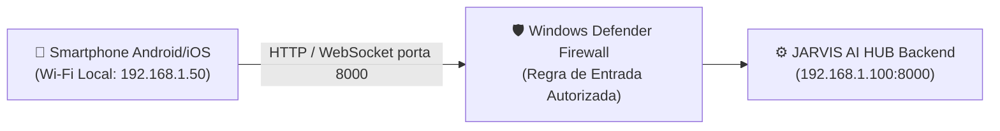

# 📶 Guia de Configuração e Pareamento Mobile via Rede Local (LAN)

> **Projeto**: JARVIS AI HUB  
> **Interface**: Aplicativo Mobile Flutter (`apps/mobile`) & Backend FastAPI  
> **Objetivo**: Conectar o aplicativo móvel diretamente ao backend do JARVIS em execução no Windows via Wi-Fi/LAN local, sem necessidade de internet externa ou VPN.

---

## 1. Visão Geral da Arquitetura LAN

Quando o smartphone está conectado à mesma rede Wi-Fi local que o computador servidor, a comunicação ocorre diretamente via TCP/HTTP:



---

## 2. Passo a Passo de Configuração no Computador (Servidor Windows)

### Passo 2.1 — Identificar o Endereço IP Local do Computador
No PowerShell do computador executando o JARVIS:

```powershell
Get-NetIPAddress -AddressFamily IPv4 -InterfaceAlias "Wi-Fi*", "Ethernet*" | 
    Where-Object { $_.IPAddress -notlike "169.254*" -and $_.IPAddress -notlike "127.*" } | 
    Select-Object InterfaceAlias, IPAddress
```
*Exemplo de saída:* `192.168.1.105`. Anote este endereço IP.

> [!TIP]
> Recomenda-se fixar o IP do computador nas configurações do roteador doméstico (reserva DHCP estática) para evitar que o IP mude a cada reinicialização.

### Passo 2.2 — Configurar a Interface de Escuta do Backend
Por padrão, o servidor de desenvolvimento inicia em `127.0.0.1` (apenas acesso local na mesma máquina). Para permitir conexões de outros dispositivos na mesma rede local:

1. **Opção A (Recomendada — Escuta em todas as interfaces locais):**
   Inicie o backend com `--host 0.0.0.0`:
   ```powershell
   .venv\Scripts\python.exe -m uvicorn apps.api.main:app --host 0.0.0.0 --port 8000
   ```
2. **Opção B (Segurança por Redirecionamento Portproxy):**
   Caso prefira manter o backend escutando apenas em `127.0.0.1`, use o redirecionamento nativo do Windows:
   ```powershell
   # Executar como Administrador no PowerShell:
   netsh interface portproxy add v4tov4 listenaddress=192.168.1.105 listenport=8000 connectaddress=127.0.0.1 connectport=8000
   ```

### Passo 2.3 — Liberar a Porta no Windows Defender Firewall
O Windows Defender bloqueia conexões de entrada por padrão. Execute no PowerShell (como Administrador) para criar uma regra restrita à rede privada:

```powershell
New-NetFirewallRule -DisplayName "JARVIS AI Hub - Mobile LAN (8000)" `
    -Direction Inbound `
    -LocalPort 8000 `
    -Protocol TCP `
    -Action Allow `
    -Profile Private
```

> [!IMPORTANT]
> Certifique-se de que a sua rede Wi-Fi está marcada como **Rede Privada** no Windows (`Configurações > Rede e Internet > Wi-Fi > Propriedades da rede > Tipo de perfil: Privado`). Se estiver como "Pública", as conexões serão bloqueadas.

---

## 3. Passo a Passo no Smartphone (App Flutter)

1. Conecte o smartphone na mesma rede Wi-Fi que o computador (certifique-se de que não está na rede de "Visitantes / Guest", que costuma isolar os aparelhos).
2. Abra o aplicativo **JARVIS Mobile**.
3. Na tela de boas-vindas / configuração do servidor, preencha:
   - **URL do Servidor**: `http://192.168.1.105:8000` *(substitua pelo seu IP anotado)*
4. Clique em **"Testar Conexão"** ou acesse pelo navegador do celular `http://192.168.1.105:8000/health`.
   - Se responder `{"status":"healthy"}`, a conectividade está estabelecida.
5. Digite suas credenciais (ou use o token administrativo gerado no setup) e clique em **Entrar**.

---

## 4. Diagnóstico de Problemas Comuns (Troubleshooting)

| Sintoma | Causa Mais Frequente | Como Resolver |
|---|---|---|
| **"Connection refused"** | Backend ouvindo apenas em `127.0.0.1` | Reiniciar com `--host 0.0.0.0` ou verificar regra portproxy. |
| **"Connection timed out"** | Firewall do Windows ou rede "Pública" | Mudar perfil de rede para Privado e adicionar regra no firewall. |
| **Página não encontrada no celular, mas funciona no PC** | Isolamento de AP (Client Isolation) no roteador Wi-Fi | Desativar "Isolamento de Ponto de Acesso / AP Isolation" no painel do roteador Wi-Fi. |
| **IP muda após reiniciar roteador** | IP dinâmico (DHCP lease) expirou | Configurar endereço IP estático no Windows ou reserva de DHCP no roteador. |
| **Erro de CORS no navegador móvel** | Domínio/origem não listado na allowlist | Adicionar o IP do host em `JARVIS_ALLOWED_ORIGINS` nas variáveis de ambiente. |

---

## 5. Checklist de Homologação da Conexão LAN

- [ ] IP local do computador identificado e estável.
- [ ] Backend ouvindo em `0.0.0.0:8000`.
- [ ] Perfil de rede definido como **Privado** no Windows.
- [ ] Regra de firewall TCP 8000 ativa para perfil Privado.
- [ ] Endpoint `http://<IP_DO_PC>:8000/health` responde HTTP 200 no navegador do celular.
- [ ] App Flutter conecta, autentica e exibe listagem de projetos e tarefas.
