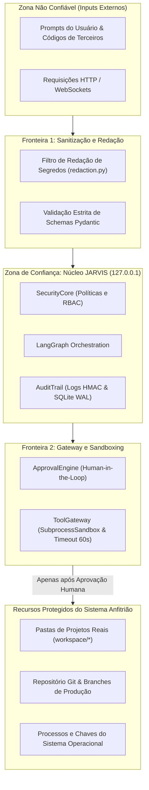

# 🛡️ Threat Model e Política de Segurança da Informação

> **Projeto**: JARVIS AI HUB  
> **Versão**: 1.0.0  
> **Classificação**: Modelo STRIDE & Políticas de Blindagem Local-First  

---

## 1. Modelo de Fronteiras de Confiança (Trust Boundaries)

---

## 2. Matriz de Ameaças STRIDE e Contramedidas

| Ameaça STRIDE | Vetor Potencial de Ataque | Contramedida de Engenharia Implementada | Status |
| :--- | :--- | :--- | :---: |
| **Spoofing** | Agente de IA falsificar identidade de administrador humano para autoaprovar patches. | `ApprovalEngine` rejeita terminantemente identidades com papéis de agentes (`UnauthorizedApprovalError`). Somente credenciais de operadores humanos autenticados são válidas. | **MITIGADO** |
| **Tampering** | Injeção de instruções que adulterem arquivos críticos do sistema operacional ou da branch `main`. | Operação padrão em modo *Read-Only*. Patches são gerados como branches isoladas `jarvis/task-{id}` em Git worktrees temporárias. | **MITIGADO** |
| **Repudiation** | Execução de alterações de código sem registro de autor ou justificativa técnica. | Cada ação gera registro imutável no `AuditTrail` contendo task_id, timestamp UTC, diff unificado, parâmetros e hash SHA-256. | **MITIGADO** |
| **Information Disclosure** | Envio de credenciais, chaves de API (`sk-...`) ou código sensível para nuvem ou logs. | Algoritmo de redaction automático ativo em todas as saídas e logs. Inferência padrão confina-se a `127.0.0.1:11434` (Ollama local). | **MITIGADO** |
| **Denial of Service** | Ataques de *Prompt Bombing* gerando inferências infinitas ou consumo excessivo de RAM/CPU. | `InferenceQueue` limita a concorrência a exatamente 1 execução pesada. Limite de 3 ciclos recursivos entre agentes. SubprocessSandbox com timeout de 60s. | **MITIGADO** |
| **Elevation of Privilege** | Path traversal (`../../`) em nomes de arquivos para ler arquivos fora do projeto. | Validador canônico `sanitize_path` resolve caminhos absolutos e aborta se o destino não pertencer ao diretório raiz autorizado. | **MITIGADO** |

---

## 3. Política de Resposta a Incidentes & Kill Switch

Em situações de comportamento anômalo ou suspeita de comprometimento:

1. **Kill Switch Global**:
   - Disponível no topo do *Security Center*.
   - Ao ser acionado (`POST /api/v1/security/kill-switch` com `{"scope": "global"}`), todas as invocações de ferramentas e inferências ativas são suspensas imediatamente em memória.
2. **Kill Switch por Tarefa**:
   - Permite abortar instantaneamente uma tarefa individual informando seu `task_id`.
3. **Scanner de CVEs Offline**:
   - Varredura de manifestos (`package.json`, `pubspec.yaml`, `requirements.txt`, `pyproject.toml`) contra banco de vulnerabilidades offline sem conexão externa.
4. **Sandbox Red Team**:
   - Auditor de código seguro capaz de simular testes de invasão e sugerir correções de código antes do commit.
